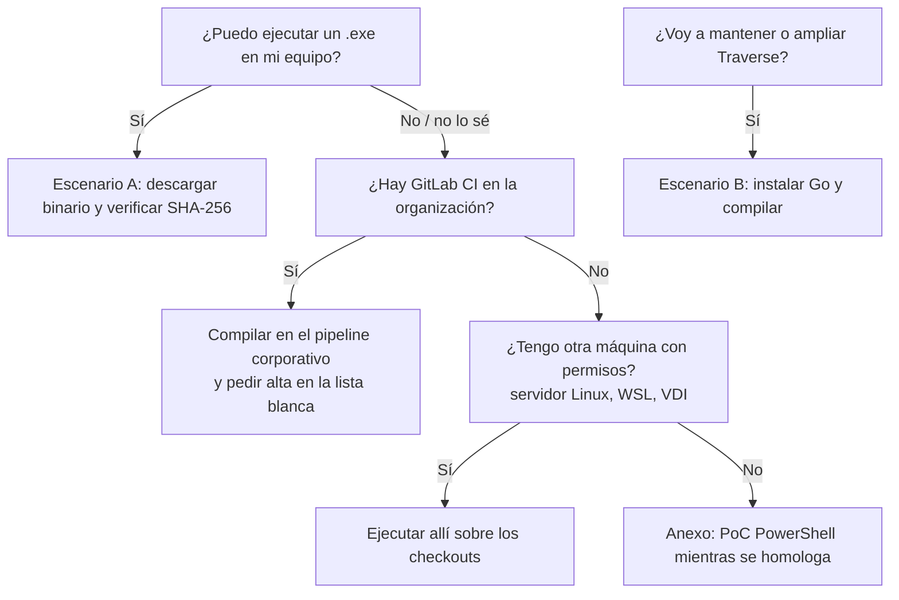

# Manual de Traverse – Offline Architecture Analyzer

> Versión 0.9.4 · Herramienta de análisis estático de arquitectura, offline y de solo lectura. ·
> Traducción de la [guía de referencia en inglés](manual.md).

## Índice

0. [Inicio rápido](#0-inicio-rápido)
1. [Qué es y qué no es](#1-qué-es-y-qué-no-es)
2. [Elige tu escenario](#2-elige-tu-escenario)
3. [Escenario A — Sin Go: usar el ejecutable](#3-escenario-a--sin-go-usar-el-ejecutable)
4. [Escenario B — Con Go: compilar desde el código fuente](#4-escenario-b--con-go-compilar-desde-el-código-fuente)
5. [Preparar el código: GitLab y Subversion](#5-preparar-el-código-gitlab-y-subversion)
6. [Ejecutar el análisis](#6-ejecutar-el-análisis)
7. [Interpretar los resultados](#7-interpretar-los-resultados)
8. [Validar los hallazgos](#8-validar-los-hallazgos)
9. [Configuración y reglas propias](#9-configuración-y-reglas-propias)
10. [Seguridad y privacidad](#10-seguridad-y-privacidad)
11. [Limitaciones](#11-limitaciones)
12. [Solución de problemas](#12-solución-de-problemas)
13. [Anexo: si no se permite ningún ejecutable](#13-anexo-si-no-se-permite-ningún-ejecutable)

---

## 0. Inicio rápido

Unos quince minutos desde cero hasta un informe de portfolio. Solo necesitas **Go 1.24 o superior**
para compilar ([sección 4.1](#41-instalar-go-sin-administrador)); el análisis no necesita nada más.
Los comandos están para **Linux/macOS** y para **Windows (PowerShell)**: son equivalentes.

**1. Compilar.** Indicar la versión hace que cada informe diga con qué versión se generó.

```sh
# Linux / macOS
git clone https://github.com/oskillarrr/traverse.git && cd traverse
go build -ldflags "-X main.version=0.9.4" -o traverse ./cmd/traverse
./traverse version                        # traverse 0.9.4 schema 1.5.0
T="$PWD/traverse"
```

```powershell
# Windows
git clone https://github.com/oskillarrr/traverse.git; cd traverse
go build -ldflags "-X main.version=0.9.4" -o traverse.exe .\cmd\traverse
.\traverse.exe version                    # traverse 0.9.4 schema 1.5.0
$T = (Resolve-Path .\traverse.exe).Path
```

**2. Probar con la demo incluida** (cinco sistemas ficticios, sin preparar nada):

```sh
"$T" scan --manifest examples/repos.csv --out ../traverse-demo
```

```powershell
& $T scan --manifest examples\repos.csv --out ..\traverse-demo
```

Abre `../traverse-demo/index.html` en cualquier navegador.

**3. Una clave para los nombres de host (recomendado).** Con clave, los hosts que aparecen en el
código se sustituyen por seudónimos estables y se guardan cifrados; sin clave, no se registran. Si
varias personas analizan el mismo portfolio, **usad la misma clave** para que los seudónimos coincidan.
Guárdala fuera de los repositorios y de los informes, y no la envíes por correo.

```sh
"$T" keygen --out ~/claves/traverse-equipo.key
```

```powershell
& $T keygen --out $HOME\claves\traverse-equipo.key
```

**4. Manifiesto.** Una línea por aplicación: `name,path,group`. `group` (área, dominio o equipo) es
opcional y genera una vista por grupo. Si una aplicación tiene varias líneas de código (`trunk`,
`trunk2`…) y quieres una concreta, apunta `path` a esa carpeta.

```csv
name,path,group
facturacion,/src/facturacion,Finanzas
contabilidad,/src/contabilidad/trunk,Finanzas
portal-web,/src/portal,Canales
```

Las rutas pueden ser absolutas o relativas al CSV. En Windows, `C:\src\facturacion`.

**5. Revisar dónde está el código.** `survey` solo lee nombres de carpetas, tamaños y descriptores de
build, y tarda segundos. Comprueba que la **línea principal** elegida es la que esperas.

```sh
tail -n +2 repos.csv | cut -d, -f2 | while read -r p; do "$T" survey --lang es "$p"; done
```

```powershell
Import-Csv repos.csv | ForEach-Object { "===== $($_.name)"; & $T survey --lang es $_.path }
```

**6. Analizar todo junto y abrir el informe.** Analizar todas las aplicaciones en una sola ejecución
es lo que saca las relaciones entre ellas.

```sh
"$T" scan --manifest repos.csv --out ~/informes/portfolio --lang es --key-file ~/claves/traverse-equipo.key
xdg-open ~/informes/portfolio/index.html      # macOS: open ...
```

```powershell
& $T scan --manifest repos.csv --out $HOME\informes\portfolio --lang es --key-file $HOME\claves\traverse-equipo.key
Start-Process $HOME\informes\portfolio\index.html
```

La carpeta de salida **debe estar fuera** de los repositorios analizados. Si existe un paquete de
reglas para tu país o sector, añádelo con `--rules` ([sección 9.3](#93-paquetes-de-reglas)).

**7. Revisar.** Empieza por el resumen ejecutivo y, en cada sistema, por **Relaciones con otras
aplicaciones**. Pide a alguien que conozca las aplicaciones que rellene `validation-sample.csv`
([sección 7.5.0.3](#7503-medir-la-fiabilidad-validation-samplecsv)). Comparte la carpeta de informes,
nunca la clave.

Si algo falla, consulta la [sección 12](#12-solución-de-problemas).

---

## 1. Qué es y qué no es

Traverse lee el código fuente de uno o varios repositorios y genera, **sin IA, sin red y sin compilar ni ejecutar nada del código analizado**:

- Un **informe por aplicación**: contexto del sistema, arquitectura por capas, interfaces expuestas y consumidas (REST, SOAP, JMS, JNDI, EJB), tablas de base de datos, módulos de build, tecnologías, riesgos, componentes, métricas de acoplamiento, ciclos y violaciones de capas.
- Un **informe de portfolio** que cruza todas las aplicaciones: qué sistema llama a qué otro, qué colas comparten, qué tablas de BD usan varias aplicaciones, qué librerías internas se consumen y en qué versiones, y qué dependencias apuntan fuera del portfolio.
- **Exportaciones en formatos estándar**, validadas contra sus esquemas o herramientas oficiales:

| Formato | Organismo / estándar | Para qué |
|---|---|---|
| Structurizr DSL | Modelo C4 (Simon Brown) | Diagramas C4 de contexto, contenedores, componentes y **despliegue** |
| C4-PlantUML | PlantUML + librería C4 | Diagramas en documentación técnica |
| ArchiMate 3.1 Model Exchange File Format | The Open Group | Importar el portfolio en Archi, Sparx EA, BiZZdesign, ADOIT… |
| SARIF 2.1.0 | OASIS | Hallazgos en GitLab, SonarQube, DefectDojo, VS Code… |
| CycloneDX 1.6 | ECMA-424 (OWASP) | SBOM de dependencias declaradas (con PURL) |
| Mermaid, SVG, CSV, JSON | — | Edición rápida, Excel, integración |

**Cobertura por tecnología:**

| Nivel | Tecnologías |
|---|---|
| Estructural (componentes, capas, dependencias, endpoints, contratos) | **Java** (1.2 → 21+), **Kotlin**, **C#** (.NET Framework y .NET 5+) |
| Módulos, imports, rutas HTTP y tablas ORM | **JavaScript/TypeScript** (Express, NestJS, TypeORM, Sequelize), **Python** (Django, Flask, FastAPI, SQLAlchemy), **PHP** (Laravel, Symfony, Eloquent), **Go** (gin, echo, chi, net/http, GORM), **Ruby** (Rails) |
| Mainframe | **COBOL** (programas, copybooks, CALL, CICS LINK/XCTL, mapas, ficheros, colas TS/TD, EXEC SQL), **JCL** (jobs, pasos, procedimientos, datasets), **BMS**, **CSD** (transacciones, ficheros→datasets), HLASM |
| Páginas de servidor | JSP, ASP.NET Web Forms/ASMX/WCF, Razor Pages, ASP clásico |
| Inventario, tecnologías y riesgos | 80 lenguajes y formatos (PL/I, RPG, Natural, VB6, Delphi, PowerBuilder, PL/SQL, REXX…) |
| Build | Maven, Ant, Ivy, Gradle, npm, Composer, MSBuild/NuGet, Python, Go y JARs incluidos en el repositorio |

Hay un catálogo de 165 reglas de tecnologías y riesgos, más paquetes de reglas opcionales por país o sector (sección 9.3). Además hay descriptores **Java EE / JBoss / Spring / Struts / WSDL / servidor**.

**No es** un sustituto del conocimiento de los equipos ni de la configuración real de producción. Sus relaciones son *candidatas con evidencia* (fichero:línea), no hechos de ejecución. Ver [Limitaciones](#11-limitaciones).

---

## 2. Elige tu escenario

Traverse está escrito en Go, pero **Go solo hace falta para compilarlo**. El resultado es un único ejecutable autónomo, sin instalador, sin dependencias y sin permisos de administrador.

| Pregunta | Escenario A — Sin Go | Escenario B — Con Go |
|---|---|---|
| ¿Para quién? | Arquitectos y analistas que solo quieren usar la herramienta | Quien mantiene la herramienta, añade reglas o la homologa |
| ¿Qué necesito instalar? | Nada | Go 1.24 o superior (un ZIP, sin admin) |
| ¿De dónde sale el ejecutable? | De una *release* publicada o del pipeline de GitLab de tu organización | Lo compilas tú: `go build ./cmd/traverse` |
| ¿Puedo ejecutar los tests? | No hace falta | Sí: `go test ./...` |
| Riesgo principal | Que la política del equipo bloquee un `.exe` no firmado | Ninguno adicional |



---

## 3. Escenario A — Sin Go: usar el ejecutable

### 3.1 Obtener el ejecutable

Elige **una** de estas fuentes. Están ordenadas de mayor a menor confianza para un entorno corporativo:

1. **Pipeline de GitLab de tu organización** (recomendado para homologar). Sube el repositorio de Traverse a vuestro GitLab: el fichero `.gitlab-ci.yml` incluido ejecuta tests, compila para todas las plataformas y publica `dist/` como artefacto descargable con su `SHA256SUMS.txt`. Así el binario sale de **vuestra** infraestructura y Seguridad puede auditar el código y, si se requiere, firmarlo.
2. **Paquete entregado** junto a este manual (carpeta `dist/`).

Si tu equipo bloquea los ejecutables que llegan de fuera, compila desde el código fuente en tu propio equipo ([sección 4](#4-escenario-b--con-go-compilar-desde-el-código-fuente)): es la vía que ha funcionado en entornos restringidos.

| Sistema | Fichero |
|---|---|
| Windows 10/11, Server (x64) | `traverse-<versión>-windows-amd64.exe` |
| Windows en ARM | `traverse-<versión>-windows-arm64.exe` |
| Linux x64 / ARM | `traverse-<versión>-linux-amd64` / `-linux-arm64` |
| macOS Intel / Apple Silicon | `traverse-<versión>-darwin-amd64` / `-darwin-arm64` |

### 3.2 Verificar la integridad

Compara el hash con el de `SHA256SUMS.txt`:

```powershell
# Windows (PowerShell 5.1 o 7)
Get-FileHash .\traverse-0.9.4-windows-amd64.exe -Algorithm SHA256
```

```sh
# Linux / macOS
sha256sum traverse-0.9.4-linux-amd64        # macOS: shasum -a 256 ...
```

### 3.3 Colocarlo y probarlo

```powershell
# Windows: una carpeta de usuario, sin permisos de administrador
New-Item -ItemType Directory C:\Herramientas\traverse -Force
Copy-Item .\traverse-0.9.4-windows-amd64.exe C:\Herramientas\traverse\traverse.exe
C:\Herramientas\traverse\traverse.exe version
```

```sh
# Linux / macOS
mkdir -p ~/bin && cp traverse-0.9.4-linux-amd64 ~/bin/traverse && chmod +x ~/bin/traverse
~/bin/traverse version
```

Si `traverse version` muestra `traverse 0.9.4 schema 1.5.0`, ya está listo: pasa a la [sección 5](#5-preparar-el-código-gitlab-y-subversion).

### 3.4 Si Windows bloquea el ejecutable

| Síntoma | Causa | Qué hacer |
|---|---|---|
| "Windows protegió su PC" (SmartScreen) | El fichero viene de Internet (marca *Mark of the Web*) | Si tu política lo permite: `Unblock-File .\traverse.exe`. Si no, usa la opción 1 de 3.1 |
| "Esta aplicación se ha bloqueado por el administrador" | AppLocker / WDAC | **No intentes eludirlo.** Solicita a Sistemas el alta del ejecutable por hash o certificado (plantilla abajo) |
| El antivirus lo pone en cuarentena | Heurística sobre ejecutables no firmados | Solicita la revisión al equipo de seguridad con el hash y el código fuente |

**Plantilla de solicitud a Sistemas / Seguridad:**

> Solicito autorizar la ejecución de la herramienta de análisis estático Traverse (código abierto, Apache-2.0).
> - Fichero: `traverse.exe` · SHA-256: `<hash>` · Ubicación: `C:\Herramientas\traverse\`
> - Función: lee ficheros de código fuente y genera informes HTML/CSV en una carpeta local.
> - No requiere instalación ni privilegios, no abre conexiones de red, no ejecuta procesos ni modifica los ficheros analizados (ver `SECURITY.md`).
> - Sin dependencias de terceros: compilado solo con la librería estándar de Go; código fuente disponible para auditoría y compilable en nuestro GitLab CI.

### 3.5 Ejecutarlo fuera de tu equipo

Si en tu puesto no se puede, puedes ejecutar Traverse en un servidor Linux, en WSL, en un escritorio virtual o en el propio runner de GitLab sobre los checkouts. Después copia la carpeta de resultados a tu equipo: los informes son HTML estáticos que se abren con cualquier navegador sin conexión.

---

## 4. Escenario B — Con Go: compilar desde el código fuente

### 4.1 Instalar Go (sin administrador)

1. Descarga el **ZIP/tar.gz** (no el instalador MSI) de Go 1.24+ desde https://go.dev/dl/ o desde el repositorio interno de software.
2. Descomprímelo, por ejemplo, en `C:\Herramientas\go` o `~/go-sdk`.
3. Añádelo al PATH **solo para la sesión**:

```powershell
$env:Path = "C:\Herramientas\go\bin;$env:Path"; go version
```

```sh
export PATH="$HOME/go-sdk/bin:$PATH"; go version
```

Traverse **no descarga módulos de terceros** (`go.mod` no tiene `require`), así que compila sin acceso a Internet ni a un proxy de módulos.

### 4.2 Compilar y probar

```sh
git clone <url-del-repositorio-traverse> && cd traverse
go test ./...                      # tests unitarios y de regresión
go run ./cmd/traverse rules test        # verifica los ejemplos de todas las reglas
go build -ldflags "-X main.version=0.9.4" -o traverse ./cmd/traverse   # Windows: -o traverse.exe .\cmd\traverse
./traverse version                 # sin -ldflags muestra "traverse dev"; funciona igual
```

### 4.3 Compilar para todas las plataformas

```sh
sh scripts/build.sh 0.9.4          # Linux/macOS/Git Bash
```

```powershell
.\scripts\build.ps1 -Version 0.9.4 # Windows PowerShell
```

Genera `dist/` con los seis ejecutables y `SHA256SUMS.txt`. La compilación es reproducible: usa `-trimpath`, sin CGO y sin rutas locales.

### 4.4 Publicar en GitLab CI

El `.gitlab-ci.yml` incluido tiene tres etapas:

- `test`: formato, `go vet`, tests, reglas y una prueba de humo sobre el portfolio de ejemplo.
- `build`: binarios multiplataforma y checksums como artefacto.
- `release`: en *tags*, conserva los binarios sin caducidad. Aquí se añade la firma de código si la organización la exige.

Si el runner no tiene Internet, replica la imagen `golang:1.24` en vuestro registro y define la variable `GO_IMAGE`.

---

## 5. Preparar el código: GitLab y Subversion

Traverse **no se conecta a GitLab ni a Subversion**. Analiza carpetas que ya están en disco. Descarga el código con tus credenciales habituales y en una ubicación autorizada.

### 5.1 GitLab

```sh
mkdir -p ~/checkouts && cd ~/checkouts
git clone --depth 1 https://gitlab.example.org/grupo/aplicacion-a.git
git clone --depth 1 --branch release/2.3 https://gitlab.example.org/grupo/aplicacion-b.git
```

`--depth 1` basta: Traverse analiza el estado actual, no el historial. Si existe la carpeta `.git`, el informe recoge la rama y el commit.

Para muchos repositorios, crea una lista `repos.txt` con una URL por línea:

```powershell
Get-Content repos.txt | ForEach-Object { git clone --depth 1 $_ }
```

```sh
while read -r url; do git clone --depth 1 "$url"; done < repos.txt
```

### 5.2 Subversion

Descarga **solo `trunk`** (o la rama que represente producción):

```sh
svn checkout https://svn.example.org/repos/aplicacion-c/trunk aplicacion-c
# o, sin metadatos .svn:
svn export   https://svn.example.org/repos/aplicacion-c/trunk aplicacion-c
```

No hace falta preparar nada: puedes apuntar a la carpeta de la aplicación tal como la tengas (con `bbdd/`, `doc/`, `ea/`, `fuente/`, ramas, entregas…). Antes de analizar, Traverse **reconoce la estructura** (sección 5.3) y analiza solo la línea principal.

### 5.3 Reconocimiento de estructura (`traverse survey`)

Antes de leer una sola línea de código, Traverse recorre los niveles de directorios (nombres,
tamaños y descriptores de build) para saber **dónde está el código** y **qué carpetas son copias del
mismo proyecto**. Puedes verlo sin analizar nada:

```powershell
.\traverse.exe survey --lang es C:\ruta\a\la\aplicacion
```

```
orders/
├─ bbdd/        datos (SQL)
├─ doc/         documentación
├─ ea/          modelos
└─ fuente/
   ├─ branches/ 83 copias           → omitidas
   ├─ develop/  copia de fuente/trunk (2.11.0)
   ├─ entregas/ 26 copias           → omitidas · 2.10.2 idéntica a trunk
   └─ trunk/    LÍNEA PRINCIPAL · maven:es.acme:orders 2.10.2
```

Reglas, todas objetivas:

- **Copias**: dos carpetas son el mismo proyecto si tienen las mismas coordenadas de build
  (`groupId:artifactId`, nombre de `package.json`, proyecto .NET…) o, sin descriptores, si comparten
  al menos el 80 % de las rutas de sus fuentes. Las coordenadas distintas nunca son copias (módulos
  distintos), y las carpetas por entorno (`int`, `pre`, `pro`, `cer`…) tampoco.
- **`branches/` y `tags/`** junto a `trunk/` se omiten siempre (también los tags anidados).
- **Línea principal**: `trunk`; si no hay, la de versión más alta; si empatan, la más reciente.
- **No es código**: documentación (`.docx`, `.pdf`…), modelos (`.eap`, `.qea`, `.archimate`…),
  binarios y **runtimes incluidos en el repositorio** (un JDK o un servidor de aplicaciones
  versionado, que se omite). Los scripts SQL sí se analizan (modelo de datos).
- **Módulos solo con binarios**: si un módulo tiene `.war`/`.ear` pero ningún código, se analiza el
  artefacto por dentro (sección 7.5.1).

Lo que se decide queda escrito en el informe, en la sección **Estructura del repositorio**. Para
analizar todas las copias como antes, usa `--layout all` (o `--svn-all`). Si una carpeta contiene
varios proyectos con su propio `trunk` (por ejemplo `notifier`, `notifier-ws`, `notifier-cli`), el
reconocimiento lo indica por si quieres analizarlos como sistemas separados.

### 5.4 Código muy antiguo

- **Codificación**: los ficheros que no son UTF-8 válido se leen como Windows-1252/ISO-8859-1, lo habitual en fuentes antiguas en español. Las tildes y eñes se conservan. Los ficheros afectados aparecen en `files.csv` (columna `encoding`).
- **Sin Maven** (Ant, JARs en `WEB-INF/lib` o `lib/`): las librerías incluidas en el repositorio se inventarían como dependencias `vendored-jar`, con su versión cuando el nombre la incluye.
- **Java 1.4 / EJB 2.x / Struts 1 / Axis 1**: tienen reglas específicas y se marcan como riesgo de migración.
- **Descriptores con DTD remotos** (`web.xml` 2.3, etc.): se leen sin descargar nada.

### 5.5 Manifiesto del portfolio

Crea `repos.csv` (UTF-8) junto a los checkouts:

```csv
name,path,group
common-lib,common-lib,Compartido
gestion-expedientes,aplicacion-c,Tramitación
notificaciones,aplicacion-a,Tramitación
portal-ciudadano,portal,Atención al ciudadano
```

- `name`: nombre del sistema en los informes.
- `path`: carpeta del checkout, absoluta o relativa al CSV.
- `group`: dominio o área (opcional). Agrupa sistemas en el mapa y en los modelos C4.
- Las líneas que empiezan por `#` se ignoran.

---

## 6. Ejecutar el análisis

### 6.1 Comandos básicos

```powershell
# Un repositorio
traverse.exe scan C:\checkouts\aplicacion-c --out C:\informes\aplicacion-c --lang es

# Varios repositorios (vista de portfolio)
traverse.exe scan C:\checkouts\app-a C:\checkouts\app-b --out C:\informes\portfolio --lang es

# Desde manifiesto (recomendado)
traverse.exe scan --manifest C:\checkouts\repos.csv --out C:\informes\portfolio --lang es
```

Abre `C:\informes\portfolio\index.html` en el navegador.

**La carpeta de salida debe estar fuera de los repositorios.** Traverse se niega a escribir dentro de ellos. Puedes ejecutar el análisis tantas veces como quieras: cada ejecución sobrescribe la carpeta de salida.

### 6.2 Opciones

| Opción | Por defecto | Uso |
|---|---|---|
| `--out DIR` | — (obligatoria) | Carpeta de resultados |
| `--manifest FILE` | — | CSV `name,path,group` |
| `--lang es\|en` | `en` (o la variable `TRAVERSE_LANG`) | Idioma de los informes |
| `--name`, `--group` | nombre de carpeta | Nombre y grupo cuando se analiza un único repositorio |
| `--config FILE` | — | `traverse.json`: exclusiones, capas, paquetes de reglas, banner de clasificación ([sección 9](#9-configuración-y-reglas-propias)) |
| `--rules FILE` | — | Reglas adicionales o un paquete de `rulepacks/` (se puede repetir; el mismo `id` sustituye a la regla de serie) |
| `--no-default-rules` | no | Usa solo las reglas de `--rules` |
| `--exclude GLOB` | — | Excluye rutas, p. ej. `--exclude "legacy/copia/**"` (se puede repetir) |
| `--keep-dir NAME` | — | Analiza un directorio excluido por defecto (`bin`, `build`, `out`...) |
| `--include-tests` | no | Incluye el código de test en componentes, grafos y riesgos |
| `--layout auto\|all` | `auto` | `auto`: analiza solo la línea principal cuando hay copias del mismo proyecto (entregas, ramas, tags). `all`: lo analiza todo |
| `--svn-all` | no | Igual que `--layout all` |
| `--key-file FILE` | `TRAVERSE_KEY_FILE` | Clave de `traverse keygen`. Activa la captura de **nombres de host cifrados** ([sección 10.1](#101-nombres-de-host-cifrados)) |
| `--include-hosts` | no | Exige la captura de hosts: falla si no hay clave configurada |
| `--vulndb RUTA` | `TRAVERSE_VULNDB` | Base de vulnerabilidades OSV **descargada previamente** (`all.zip` o carpeta). Activa el cruce de vulnerabilidades ([sección 7.8](#78-vulnerabilidades-conocidas-osv-sin-conexión)). Se puede repetir |
| `--min-confidence low\|medium\|high` | `low` | Confianza mínima de las relaciones que se **dibujan** en los diagramas. Las tablas y CSV las conservan todas |
| `--max-file-size MB` | 5 | Los ficheros más grandes se inventarían, pero no se analizan |
| `--max-nodes N` | 60 | Paquetes dibujados en el diagrama de capas |
| `--classification TXT` | — | Banner en todos los informes, p. ej. "Uso interno" |
| `--workers N` | nº de CPU | Paralelismo |

Directorios excluidos siempre (salvo `--keep-dir`): `.git .svn CVS .idea .vscode .settings node_modules target build dist out bin obj classes vendor packages __pycache__ .venv` y similares.

### 6.3 Otros comandos

```sh
traverse survey --lang es RUTA       # estructura: dónde está el código, copias y línea principal (no lee código)
traverse survey --out informes RUTA  # además escribe survey.md y survey.json
traverse rules list > reglas.csv     # catálogo de reglas
traverse rules test --rules mis-reglas.json
traverse keygen --out equipo.key     # crea la clave para cifrar hosts
traverse reveal --key-file equipo.key informes/portfolio   # descifra los pseudónimos (CSV por pantalla)
traverse vulndb info osv/2026-11-03            # comprueba una base OSV: ecosistemas, avisos y fecha de los datos
traverse version
```

### 6.4 Rendimiento orientativo

Un repositorio sintético de 60 MB y 5.000 ficheros Java se analiza en unos 26 s con 2 CPU. Los 13 proyectos reales de la verificación (unos 6.000 ficheros, 9 tecnologías) se analizan en unos 8 s, con todas las salidas incluidas.

---

## 7. Interpretar los resultados

> Tienes un informe ya generado en `examples/demo-report/index.html`. Corresponde a un portfolio ficticio de 5 sistemas (Java/JBoss en SVN, Spring Boot en Git, .NET + COBOL, una librería común y un repositorio GitOps). Se ha generado con la base de vulnerabilidades **sintética** de `examples/demo-vulndb`, que no contiene avisos reales. Está en inglés; para verlo en español, regenera la demo con `--lang es` (sección 0, paso 2).

### 7.1 Estructura de la carpeta de salida

```
informes/portfolio/
├── index.html               ← informe de portfolio (empieza aquí)
├── landscape.svg / .mmd / .puml
├── workspace.dsl            ← modelo C4 del portfolio (Structurizr)
├── portfolio.md             ← documento del portfolio centrado en integraciones (Markdown)
├── portfolio.json
├── hosts.vault.json         ← hosts cifrados (solo si hay clave)
├── systems.csv  links.csv  shared-tables.csv  library-versions.csv
├── external-dependencies.csv  technologies.csv
├── validation-sample.csv    ← 20 afirmaciones para medir la fiabilidad (sección 7.5.0.3)
├── areas/<área>/            ← vista por área, si el manifiesto tiene grupos (sección 7.5.0.2)
├── vulnerabilities.csv      ← vulnerabilidades del portfolio (solo con --vulndb)
└── systems/<sistema>/
    ├── report.html          ← informe de la aplicación (con resumen ejecutivo)
    ├── report.md            ← mismo análisis en Markdown, poblado (resumen, métricas, integraciones, datos, vulnerabilidades, riesgos)
    ├── arc42.md             ← documentación arc42 prerrellenada (Markdown)
    ├── facts.json           ← todos los hechos extraídos (formato estable)
    ├── context.svg  architecture.svg  deployment.svg  architecture.mmd  workspace.dsl
    ├── deployment.csv       ← imágenes, servicios Compose y objetos Kubernetes/OpenShift
    ├── findings.sarif       ← hallazgos en SARIF 2.1.0
    ├── sbom.cdx.json        ← SBOM CycloneDX 1.6 (con --vulndb, incluye `vulnerabilities`)
    ├── vulnerabilities.csv  vulnerabilities-unevaluated.csv   ← solo con --vulndb
    └── files.csv  modules.csv  build-dependencies.csv  deployables.csv
        components.csv  code-dependencies.csv  contracts.csv  findings.csv
        package-metrics.csv  cycles.csv  layer-violations.csv  diagnostics.csv
```

En la raíz también están `architecture.archimate.xml` (modelo ArchiMate del portfolio) y `findings.sarif` (todos los sistemas).

Los CSV están en UTF-8 con BOM, así que Excel los abre con las tildes correctas. Además se neutralizan las fórmulas para evitar inyección.

### 7.2 Informe de portfolio (`index.html`)

| Sección | Qué responde |
|---|---|
| **Mapa de sistemas** | Qué sistemas existen y cómo se relacionan. El color indica el tipo de relación (library, http, soap, jms, ejb, shared-db) |
| **Sistemas** | Tamaño, lenguajes, módulos, interfaces expuestas y consumidas, tablas, runtime, unidades de despliegue y riesgos (Alto/Medio/Bajo) |
| **Relaciones** | Cada enlace entre sistemas con su tipo, nº de evidencias, confianza y claves (ruta HTTP, cola, tabla, artefacto) |
| **Tablas compartidas** | Tablas que usan varias aplicaciones y con qué acceso (lee, escribe, define). Es un indicio clave de acoplamiento por BD |
| **Librerías compartidas** | Librerías internas o externas usadas por varios sistemas y **divergencia de versiones** |
| **Dependencias fuera del portfolio** | Llamadas a servicios que no expone ningún sistema analizado: candidatos a sistemas externos |
| **Matriz de tecnologías** | Tecnología × sistema (nº de ficheros con evidencia) |

**Cómo se descubren las relaciones:**

| Tipo | Evidencia que se cruza |
|---|---|
| `library` | Dependencia Maven/Gradle/npm/NuGet de un sistema = módulo producido por otro (o JAR incluido con el mismo nombre) |
| `http` | Ruta llamada desde un cliente (URL literal, `@FeignClient`, `@RegisterRestClient`, `jaxws:client`) = ruta expuesta por otro sistema (context root + ruta de aplicación + `@Path`/`@RequestMapping`) |
| `jms` / `kafka` | Destino usado o publicado por uno = destino consumido por otro (MDB, `@JmsListener`, `@KafkaListener`, `ejb-jar.xml`, Spring XML) |
| `shared-db` | Misma tabla referenciada por varios sistemas (JPA `@Table`, SQL en literales, scripts `.sql`, `EXEC SQL` en COBOL) |
| `shared-datasource` | Mismo nombre JNDI de datasource (confianza baja) |
| `shared-dataset` | Mismo dataset mainframe (DSN) usado por varios sistemas: JCL, ficheros CICS |
| `cics-transaction` / `program` | Transacción CICS o programa COBOL invocado por un sistema y definido en otro |

**Confianza de las tablas compartidas:** si dos sistemas solo coinciden en el **nombre** de la tabla (USERS existe en todas partes), la relación se marca con confianza **baja**. Sube a **media** cuando además coincide el **esquema** (`CASES.EXPEDIENTE`) o el **datasource**. La columna `basis` de `shared-tables.csv` indica en qué se basa.

**Llamadas internas:** si una llamada HTTP coincide con un endpoint del propio sistema (por ejemplo, entre microservicios del mismo repositorio), se considera interna y no se enlaza con otros sistemas. Una coincidencia que solo se produce a través de variables de ruta tiene confianza baja.

Para evitar enlaces falsos, una ruta HTTP necesita al menos dos segmentos literales, y se prefiere siempre la coincidencia más específica.

### 7.3 Informe de aplicación (`systems/<sistema>/report.html`)

- **Contexto del sistema**: qué expone (entrada), qué consume (salida), datos y plataforma. Es una vista de nivel 1 del modelo C4.
- **Unidades de despliegue**: WAR/EAR/EJB con su *context root* y rutas de aplicación (de `jboss-web.xml`, `application.xml`, `web.xml`, `@ApplicationPath`, `server.servlet.context-path`).
- **Arquitectura por capas**: paquetes por capa (Presentación, Negocio, Integración, Persistencia, Modelo, Configuración, Transversal) y sus dependencias. **Las líneas rojas son dependencias prohibidas**, por ejemplo Presentación → Persistencia.
- **Violaciones de capas** y **ciclos**: con fichero y línea.
- **Interfaces e integraciones**: cada contrato con tipo, dirección, clave, componente, confianza y ubicación.
- **Acceso a datos**: tablas, tipo de acceso y componentes implicados.
- **Módulos y build**: coordenadas, versión, empaquetado, nivel de Java/.NET y dependencias (las de `dependencyManagement` se marcan como *managed* y no cuentan como uso).
- **Tecnologías** y **Riesgos**: con severidad, regla, fichero, líneas y recomendación.
- **Componentes**: cada clase con su capa y el **motivo** de la clasificación: `stereotype:@Stateless`, `extends:HttpServlet`, `package:dao`, `name:*Service`, `config:...`.
- **Acoplamiento de paquetes**: Ca (aferente), Ce (eferente) e inestabilidad I = Ce/(Ca+Ce).

Todas las tablas se pueden filtrar y ordenar haciendo clic en la cabecera. El informe funciona en modo claro y oscuro y no carga nada de Internet.

### 7.4 Vista de despliegue

Traverse lee la infraestructura como código del repositorio con un lector propio, sin herramientas externas:

| Fuente | Qué se extrae |
|---|---|
| **Dockerfile** | Imágenes base (por etapa), puertos, usuario, nombres de `ENV`/`ARG` y si hay `HEALTHCHECK` |
| **Docker Compose** (incluidos los override) | Servicios, imagen o contexto de build (enlazado al módulo de código), puertos, réplicas, `depends_on`/`links` y referencias entre servicios en variables de entorno (se detecta el nombre del servicio, nunca se guarda el valor) |
| **Kubernetes** | Deployment, StatefulSet, DaemonSet, Job, CronJob (con planificación), Pod, Service (y selector → cargas), Ingress (host cifrado, rutas → Service), ConfigMap y Secret (solo claves), HPA |
| **OpenShift** | DeploymentConfig, Route |
| **Helm** | Plantillas (las directivas `{{ }}` se neutralizan) |

Riesgos de despliegue detectados: imagen base sin versión o `latest`, imagen base sin soporte (Java 8, Node < 18, Python 2, WildFly < 20…), contenedor como root, `ADD` desde URL, contenedor privilegiado, contenedor sin límites de recursos y Secret con datos en el repositorio.

**Entre repositorios:** si un repositorio de plataforma o GitOps despliega una imagen cuyo nombre coincide con un módulo o sistema del portfolio, aparece la relación `deploys`.

### 7.5 Resumen ejecutivo y exportación a Markdown

Cada informe (de aplicación y de portfolio) empieza por un **resumen ejecutivo**: tamaño y stack,
despliegue, integraciones, vulnerabilidades, riesgos y acoplamiento, en unas pocas líneas.

Además del HTML, el análisis completo se exporta a **`report.md`** por sistema: un informe en
Markdown ya poblado (métricas, lenguajes, tecnologías, integraciones, acceso a datos, despliegue,
vulnerabilidades, riesgos y acoplamiento), cómodo de versionar en Git, revisar en un merge request o
pegar en una wiki. A diferencia de `arc42.md`, no lleva secciones "por completar": es el equivalente
en texto de `report.html`.

### 7.5.0 Autenticación, mTLS e inventario de terceros

La sección **Autenticación y transporte** del informe (y de `report.md`) reúne:

- **Mecanismos de autenticación** detectados: autenticación de contenedor (`web.xml`), Spring
  Security, OAuth2/OIDC, JWT, SAML, CAS, Keycloak, Kerberos/SPNEGO, LDAP/AD, WS-Security en SOAP,
  API keys y credenciales Basic/Bearer en clientes, eIDAS, y firma electrónica según estándares:
  XML-DSig, CMS/PKCS#7, firma PDF, XAdES/CAdES/PAdES (DSS), sellado de tiempo RFC 3161 y tokens
  PKCS#11. El conocimiento propio de un país o sector va en paquetes de reglas opcionales
  (ver «Paquetes de reglas»).
- **mTLS (certificado de cliente)**: `CLIENT-CERT` en `web.xml`, `clientAuth` en el conector de
  Tomcat, `verify-client` y `security-realm` en WildFly, `server.ssl.client-auth` en Spring Boot y
  keystores de cliente en el código (`KeyManagerFactory`, `TLSClientParameters`…).
- **Puntos débiles**: llamadas salientes por HTTP sin cifrar, SOAP sin WS-Security, verificación TLS
  desactivada y protocolos TLS obsoletos.
- **Inventario de sistemas de terceros**: cada sistema externo con el que habla la aplicación, con
  dirección, protocolo, transporte (TLS / sin cifrar), autenticación y evidencia (fichero:línea).

Desde la versión 0.8.2:

- **La autenticación se separa por tipo**: *login de usuarios*, *entre servicios*, *firma
  electrónica* y *transporte (TLS/mTLS)*. Un login propio (una clase que implementa
  `AuthenticationProvider` o extiende `AbstractAuthenticationProcessingFilter`) aparece con el nombre
  de la clase. AutoFirma (con el paquete `es-public-sector`) en una pantalla de login cuenta como login con
  certificado; en el resto, como firma. También se detectan el SSO por cabeceras de pasarela, Keycloak (adaptador, `keycloak.json`,
  `KEYCLOAK-SAML`), el `security-domain` de JBoss y `clientAuthentication` en el `server.xml` de Liberty.
- **Si no hay ningún login en el código**, el informe lo dice: *"Login de usuarios: no visible en el
  código (posiblemente delegado en la infraestructura)"*.
- **mTLS entrante**, en uno de tres estados:
  - *lo exige el propio servidor* (`CLIENT-CERT`, `clientAuth`, `verify-client`, `server.ssl.client-auth`…);
  - *en un intermediario (inferido)*: el código lee de una cabecera HTTP el certificado de cliente o
    datos de él (sujeto, número de serie, resultado de la verificación). Lo detecta en
    `@RequestHeader`, `@HeaderParam` o `getHeader` con una cabecera de certificado, en nombres
    habituales como `SSL_CLIENT_CERT`, `X-SSL-Client-Cert`, `X-Client-Cert`,
    `X-Forwarded-Client-Cert` o `X-ARR-ClientCert`, o en una cabecera de certificado configurada.
    Es la señal de que un proxy, API gateway o balanceador termina el mTLS y reenvía el certificado;
  - *no visible en el código*: aun así, un intermediario puede exigir certificado sin que la
    aplicación lo vea.

  En el caso inferido, **cada endpoint** afectado sale con transporte *mTLS en intermediario
  (inferido)*: los del controlador que lee la cabecera o, si se lee en un filtro o interceptor, todas
  las API del módulo. `contracts.csv` los lista con las columnas `transport` y `auth`. Quién exige el
  mTLS (un consumidor, una norma) y qué consumidores se conectan no está en el código: `arc42.md` deja
  un apartado ✍️ para anotarlo.
- **Las contrapartes tienen nombre** cuando el código lo da: el paquete del cliente
  (`orders.negocio.payrollWS` → *payroll*), la clave de configuración (`signer.url` → *signer*), el JNDI
  (`java:/Mail` → *servidor de correo*), un **esquema de base de datos de otro sistema**
  (`AUDIT.*` → *esquema AUDIT*) o un **módulo de plataforma propio** (`es.acme.ledger`).
- **Integraciones declaradas en la configuración**: las URL de `.properties`, YAML, XML de Spring,
  `standalone.xml` y `server.xml` (HTTP/SOAP, JDBC, LDAP, SMTP, FTP/SFTP, AMQP…) son integraciones
  salientes, con transporte y host cifrado. Una URL base declarada en la configuración de un sistema
  se enlaza con el sistema del portfolio que expone rutas bajo ella.
- **Interfaces entrantes**: se distinguen la **API** para otros sistemas (`@RestController`,
  `@ResponseBody`, JAX-RS, SOAP, rutas `/ws`, `/api`, `/rest`) de las **pantallas**.
- **Keystores**: se mira qué contienen sin descifrar nada. Con clave privada es riesgo **alto**; un
  truststore con solo certificados públicos es **informativo**. También se reconocen las copias con
  sufijo (`.jksOLD`, `.p12.bak`).

> **Límite:** Traverse ve lo **configurado** en el código y los descriptores. No puede afirmar que un
> balanceador o frontal **exija** mTLS en producción, ni descubrir consumidores entrantes que no
> estén declarados en el código. Úsalo como inventario de partida y valídalo con infraestructura.

### 7.5.0.1 Relaciones: a quién llama y quién le llama

Cada informe de aplicación (HTML y `report.md`) tiene la sección **Relaciones con otras aplicaciones**:

- **A quién llama**: una fila por aplicación destino, con protocolos, número de endpoints, transporte
  (TLS, mTLS o sin cifrar), autenticación, entornos que la declaran y evidencia. El destino se nombra
  con lo que dice el código: el context root de la URL, el cliente SOAP, la clave de configuración, el
  esquema de BD o el módulo de plataforma.
- **Quién le llama**: los sistemas **analizados** que le llaman, con evidencia. Para saber quién
  consume una interfaz hay que analizar también al consumidor; por eso conviene un portfolio lo más
  completo posible.
- **Interfaz con varios candidatos**: si varios sistemas analizados implementan la interfaz que se
  llama (típico de un servicio de aviso que cada aplicación implementa), la relación sale con
  confianza media y la nota "N sistemas implementan la interfaz". A cuál se llama lo decide la
  configuración en ejecución.
- **Sin consumidor identificado**: interfaces expuestas que ningún sistema analizado llama,
  separadas en API, pantallas y otras.
- **Certificados**: Traverse lee los certificados públicos del repositorio (ficheros PEM/DER, también
  sin extensión, y entradas de truststores JKS) sin descifrar nada. Muestra:
  - **los certificados de aplicaciones o servidores de confianza**: por ejemplo, los clientes que una pasarela
    de firma tiene registrados en su configuración;
  - **la identidad propia**: el certificado de las entradas con clave privada;
  - **las CA de confianza**;
  - **la caducidad**: un certificado caducado o que caduca en menos de 90 días genera un hallazgo.

  De los certificados de persona física no se guarda ni el sujeto ni el alias. Una CA nunca se
  considera persona física. Los nombres de host que aparezcan en cualquier parte del sujeto o del
  alias se sustituyen por `‹host›` y se cifran como el resto de hosts.

### 7.5.0.2 Vistas por área

Si el manifiesto (`repos.csv`) asigna grupos (columna `group`), además del portfolio global se genera
una vista por área en `areas/<área>/` (`index.html`, `portfolio.md` y diagramas). Cada vista incluye los
sistemas del área y, de otras áreas, solo los que se relacionan con ella. Así se ven también las
relaciones entre áreas. Lanza siempre el análisis global: si analizas cada área por separado, las
relaciones con otras áreas aparecen como dependencias externas.

### 7.5.0.3 Medir la fiabilidad: `validation-sample.csv`

En la carpeta de salida, `validation-sample.csv` contiene 20 afirmaciones del análisis, escogidas de
forma determinista entre cinco tipos: relaciones entre sistemas, llamadas salientes, autenticación,
riesgos altos y estructura. Cada fila lleva su evidencia. Pide a alguien que conozca las aplicaciones
que rellene la columna de veredicto con uno de estos valores: *correcto*, *falso positivo*,
*incompleto* o *no verificable*.

La precisión es correctos ÷ (correctos + falsos positivos). Los *incompletos* indican lo que falta.
Con el mismo código se obtiene siempre la misma muestra, así que varias personas pueden revisar la
misma lista y comparar resultados.

### 7.5.1 Módulos entregados solo como binario (WAR/EAR)

Si un módulo no tiene código fuente pero sí un `.war` o `.ear` (por ejemplo, una aplicación de
terceros, como una pasarela de firma), Traverse **lo lee por dentro, sin descomprimirlo ni ejecutarlo**:

- `WEB-INF/web.xml` y otros descriptores (seguridad, `CLIENT-CERT`, servlets…).
- La configuración de `WEB-INF/classes` (URL de integraciones, credenciales sospechosas).
- Las librerías de `WEB-INF/lib` y `lib/`, que pasan al SBOM y al cruce de vulnerabilidades.
- La versión real del artefacto, comparada con la del `pom.xml`. Si no coinciden, se avisa en los
  diagnósticos (`artifact-version-mismatch`).

Cada hallazgo apunta a su origen con la forma `sign-gateway-2.4-INT.war!/WEB-INF/web.xml`. Hay
límites de tamaño y de número de entradas para protegerse de artefactos malformados.

### 7.5.2 Documentación arc42 (Markdown)

Cada sistema tiene también `arc42.md`, una documentación de arquitectura con las 12 secciones de [arc42](https://arc42.org). Se rellena con lo que sale del código y marca con ✍️ lo que debe completar una persona:

| Sección | Contenido generado |
|---|---|
| 1 Introducción | Tamaño, lenguajes, módulos (objetivos ✍️) |
| 2 Restricciones | Runtimes, servidores, BBDD detectados |
| **3 Contexto** | Diagrama de contexto (Mermaid) y **catálogo de integraciones**: dirección (entrante, saliente o compartida), tipo, contraparte (sistema del portfolio, externo con host cifrado o recurso del servidor), clave, **modo** (síncrona, asíncrona, por datos compartidos, en compilación o despliegue), componente, evidencia `fichero:línea` y confianza. Incluye un resumen por contraparte |
| 4 Estrategia | Tecnologías por área |
| 5 Bloques | Contenedores, dependencias entre módulos, componentes por capa (Mermaid), ciclos y violaciones |
| 6 Ejecución | Escenarios **derivados estáticamente**: de cada punto de entrada (endpoint, cola, job batch) a las integraciones de salida alcanzables |
| 7 Despliegue | Unidades de despliegue, infraestructura como código (Mermaid), recursos que debe dar el servidor |
| 8 Conceptos transversales | Seguridad, persistencia, logging, planificación, configuración |
| 9 Decisiones | ADR encontrados en el repositorio (decisiones ✍️) |
| 10 Calidad | Indicadores: ratio de test, ciclos, violaciones, % sin capa (requisitos ✍️) |
| 11 Riesgos | Riesgos priorizados con evidencia |
| 12 Glosario | Términos candidatos: entidades, tablas, transacciones |

`portfolio.md` documenta el conjunto: catálogo de sistemas, mapa (Mermaid), **matriz de integraciones** sistema × sistema, **catálogo de integraciones entre sistemas** con modo y confianza, datos compartidos, librerías y versiones, y dependencias externas.

Los diagramas son bloques Mermaid que GitLab muestra directamente. Para publicarlos en el wiki basta con copiar los ficheros.

### 7.6 Relaciones de confianza baja

Las relaciones candidatas que necesitan validación se dibujan **atenuadas** (línea fina y punteada) y con la etiqueta "confianza baja" en el SVG, Mermaid, Structurizr (etiqueta `low-confidence`) y PlantUML (`$tags="low"`). Para que no aparezcan en los diagramas usa `--min-confidence medium`: seguirán en las tablas, en los CSV y en el catálogo de integraciones.

### 7.7 Usar los diagramas en la documentación oficial

| Fichero | Herramienta (offline) | Uso |
|---|---|---|
| `*.svg` | Navegador, Word, PowerPoint, draw.io | Insertar directamente |
| `workspace.dsl` | Structurizr Lite (on-premise) o CLI | Modelo C4 editable: contexto, contenedores, componentes |
| `landscape.puml` | `plantuml.jar` (incluye la librería C4, sin red) | Diagramas C4 en documentación técnica |
| `*.mmd` | Mermaid CLI, GitLab (renderiza Mermaid en Markdown) | Editar y versionar en el wiki |
| `architecture.archimate.xml` | Archi (*File → Import → Open Exchange XML Model*), Sparx EA, BiZZdesign | Modelo de arquitectura empresarial: sistemas, interfaces, datos, plataformas, relaciones y una vista de portfolio |
| `findings.sarif` | GitLab (informe SAST), SonarQube, DefectDojo, extensión SARIF de VS Code | Gestionar los riesgos como hallazgos |
| `sbom.cdx.json` | OWASP Dependency-Track, herramientas CycloneDX | Inventario de componentes (directos y, si hay lockfile, transitivos). Con `--vulndb` incluye las vulnerabilidades en formato CycloneDX 1.6 |

**Correspondencia con ArchiMate 3.1:** sistema → *Application Component*; interfaces expuestas por tipo → *Application Interface*; tablas y datasets → *Data Object* con *Access* (lectura/escritura); runtimes, servidores y BBDD → *System Software* con *Serving*; WAR/EAR → *Artifact* con *Realization*; llamadas → *Serving* (el proveedor sirve al consumidor); mensajería y datasets compartidos → *Flow*; tablas compartidas → *Association*; grupos del manifiesto → *Grouping*.

> No subas estos ficheros a servicios web públicos (Mermaid Live, PlantUML server, etc.) sin autorización: describen la arquitectura interna.

### 7.8 Vulnerabilidades conocidas (OSV sin conexión)

Traverse puede cruzar las versiones de las librerías de cada sistema con la base pública de
vulnerabilidades **OSV** (osv.dev, mantenida por Google y la OpenSSF). Esta base agrupa los avisos de
GitHub, PyPI, Go, RustSec y otras fuentes, y casi todos llevan su CVE. **Traverse no se conecta a nada**:
la base se descarga aparte y se le pasa con `--vulndb`.

**1. Descargar la base** en un equipo autorizado con salida a Internet. Solo necesitas los ecosistemas que uses:

| Ecosistema | URL |
|---|---|
| Java (Maven, Gradle, JAR) | `https://osv-vulnerabilities.storage.googleapis.com/Maven/all.zip` |
| JavaScript (npm, yarn, pnpm, bun) | `https://osv-vulnerabilities.storage.googleapis.com/npm/all.zip` |
| .NET (NuGet) | `https://osv-vulnerabilities.storage.googleapis.com/NuGet/all.zip` |
| Python (PyPI) | `https://osv-vulnerabilities.storage.googleapis.com/PyPI/all.zip` |
| PHP (Composer) | `https://osv-vulnerabilities.storage.googleapis.com/Packagist/all.zip` |
| Go | `https://osv-vulnerabilities.storage.googleapis.com/Go/all.zip` |

Basta un navegador. También puedes usar `scripts/fetch-osv.sh` (Linux/macOS) o
`scripts/fetch-osv.ps1` (Windows), que descargan en una carpeta con la fecha y calculan el SHA-256.
Guarda cada zip con el nombre de su ecosistema (`Maven-all.zip`…) o en una subcarpeta por ecosistema.
Comprueba lo descargado con:

```sh
traverse vulndb info osv/2026-11-03
```

`vulndb info` marca cada ecosistema como `complete` o `partial`. Un ecosistema es *partial*
cuando solo aparece en avisos compartidos dentro del zip de otro ecosistema: por ejemplo, el zip
de Maven contiene unas decenas de avisos que también afectan a npm. Los ecosistemas *partial*
**no se evalúan**: sus librerías salen como `ecosystem-not-loaded` hasta que descargues su propio
`all.zip`.

**2. Analizar con la base:**

```sh
traverse scan --manifest repos.csv --out informes --vulndb osv/2026-11-03
```

**3. Dónde aparecen los resultados:**
- En el informe de cada aplicación, en la sección *Vulnerabilidades conocidas*.
- En la sección 11.1 de `arc42.md` y en la sección 8 de `portfolio.md`.
- En `vulnerabilities.csv`, que tiene una columna `validation` para anotar la revisión.
- En `findings.sarif`, con la regla `VULN/<id>`.
- En `sbom.cdx.json`, dentro de `vulnerabilities` (CycloneDX 1.6).

**Qué versiones se evalúan:**

| Origen | Ejemplo | Confianza |
|---|---|---|
| Versión exacta en el descriptor de build | `pom.xml`, `packages.config`, `requirements.txt` con `==`, `go.mod` | alta |
| Versión fijada por un *lockfile* del repositorio, incluidas las **transitivas** | `package-lock.json`, `yarn.lock`, `pnpm-lock.yaml`, `bun.lock`, `composer.lock`, `packages.lock.json`, `poetry.lock`, `uv.lock`, `Pipfile.lock`, `gradle.lockfile` | alta |
| Versión central de .NET | `Directory.Packages.props`, también con propiedades `$(...)` | alta |
| JAR incluido en el repositorio con metadatos Maven | `WEB-INF/lib/x.jar` con `META-INF/maven/.../pom.properties` | alta |
| JAR identificado solo por el nombre del fichero | `commons-lang-2.6.jar` | media, o baja si el nombre es ambiguo |
| Referencia de ensamblado .NET | `<Reference Include="log4net, Version=1.2.10.0">` | baja (es la versión del ensamblado, no la del paquete) |

**Qué no se evalúa, y por qué.** Nunca se da por segura una librería sin evaluar. Todas aparecen en
`vulnerabilities-unevaluated.csv`, con el motivo:

| Motivo | Significado | Qué hacer |
|---|---|---|
| `external-bom` | La versión la fija un POM padre o un BOM que no está en el repositorio (Spring Boot, JBoss BOM, plugin de Gradle) | Añadir al análisis el repositorio del POM padre si es corporativo. Si es público, revisar en su BOM la versión correspondiente |
| `range` | Rango (`^1.2`, `~1.2`, `[1.0,2.0)`) sin lockfile | Generar y versionar el lockfile del proyecto |
| `unresolved` | Propiedad `${...}` sin definir en el repositorio | Igual que `external-bom` |
| `missing` | No hay versión declarada | Revisar el descriptor |
| `ecosystem-not-loaded` | No se ha descargado la base de ese ecosistema | Descargarla |

**Severidad.** Cuando el aviso trae un vector CVSS v3, Traverse calcula la puntuación con la fórmula
oficial de FIRST. Si no lo trae, usa la severidad de la fuente. Los paquetes **maliciosos** conocidos
(identificadores `MAL-`) se marcan como críticos.

**Antigüedad.** Si los datos tienen más de 30 días, Traverse avisa en la consola y en `diagnostics.csv`
(`vulndb-stale`). Descarga la base con la misma frecuencia con la que generes informes.

> **Dependency-Track (opcional).** Si tu organización tiene OWASP Dependency-Track, puedes subirle
> `sbom.cdx.json`: es CycloneDX 1.6 estándar. Traverse no lo necesita.

> Los resultados son **candidatos**: OSV indica que esa versión está afectada, pero no si el código
> usa la parte vulnerable. Prioriza por severidad, exposición del sistema y uso real.

---

## 8. Validar los hallazgos

Traverse trabaja con evidencias, no con certezas. Antes de llevar un resultado al documento oficial:

1. **Prioriza**: riesgos *Alto*, relaciones entre sistemas y tablas compartidas.
2. **Comprueba la evidencia**: cada fila tiene `fichero:línea`. Ábrelo y confírmalo.
3. **Registra la decisión** en la columna `validation` de `findings.csv`: `confirmado`, `probable`, `descartado` o `no-verificable`.
4. **Contrasta** lo que el código no muestra con los responsables de la aplicación y de la infraestructura (sección 11).

Para medir la fiabilidad del conjunto, usa la muestra de `validation-sample.csv` ([sección 7.5.0.3](#7503-medir-la-fiabilidad-validation-samplecsv)).

Los identificadores de hallazgo (`id`) son **estables**: no dependen del número de línea. Puedes cruzar tus validaciones con una nueva ejecución mediante `id` (por ejemplo, con BUSCARV en Excel). La aplicación automática de validaciones entre ejecuciones está en la hoja de ruta.

---

## 9. Configuración y reglas propias

### 9.1 `traverse.json`

```json
{
  "classification": "Uso interno",
  "exclude": ["**/generated/**", "legacy/copia-antigua/**", "*.min.js"],
  "layers": {
    "overrides": {
      "es.org.expedientes.fachada": "Business",
      "es.org.expedientes.ws": "Presentation"
    },
    "tokens": {
      "Business": ["tramite", "expediente"],
      "Integration": ["sap", "signer"]
    }
  },
  "rules": ["rulepacks/mi-organizacion.json"]
}
```

- `exclude`: rutas que no se analizan, relativas a cada repositorio.
- `rules`: ficheros de reglas o paquetes que se cargan tras el catálogo de serie, con rutas
  relativas al propio `traverse.json` (ver 9.3).
- `layers.overrides`: fuerza la capa de un paquete o clase y todo lo que cuelga de él. Tiene máxima prioridad.
- `layers.tokens`: añade palabras de paquete propias de tu organización. Capas válidas: `Presentation`, `Business`, `Integration`, `Persistence`, `Model`, `Configuration`, `Cross-cutting`.

### 9.2 Reglas propias

Las reglas son datos JSON con expresión regular (sintaxis RE2) y **ejemplos obligatorios** que se verifican automáticamente:

```json
{
  "version": "local-1",
  "rules": [{
    "id": "LOCAL-FWK",
    "title": "Framework corporativo antiguo",
    "category": "Framework", "technology": "Framework corporativo",
    "severity": "medium", "confidence": "high",
    "languages": ["Java"],
    "pattern": "\\borg\\.example\\.fwk\\.",
    "message": "Framework discontinuado: planificar sustitución.",
    "examples": {
      "match":   ["import org.example.fwk.base.BaseAction;"],
      "noMatch": ["// import org.example.fwk.base.BaseAction;"]
    }
  }]
}
```

```sh
traverse rules test --rules reglas-locales.json
traverse scan --manifest repos.csv --rules reglas-locales.json --out informes
```

- Las reglas se aplican sobre el código **sin comentarios**, así que el código comentado no genera falsos positivos.
- `pathPattern` (en lugar de `pattern`) detecta por ruta de fichero, p. ej. `"\\.jks$"`.
- Una regla con el mismo `id` que una de serie la sustituye.
- `authKind` (opcional) coloca una regla de autenticación en la sección de seguridad: `user`
  (login), `service` (entre servicios), `signature` (firma electrónica) o `transport` (TLS/mTLS).
- Si una regla puede ser útil para otros, propónla al proyecto (ver `CONTRIBUTING.md`).

### 9.3 Paquetes de reglas

Traverse es **agnóstico**: el catálogo de serie reconoce estándares y productos usados en
cualquier país (Spring Security, OAuth2, SAML, eIDAS, XML-DSig, XAdES/CAdES/PAdES, RFC 3161,
PKCS#11…), nunca las plataformas propias de un país, sector u organización. Ese conocimiento va en
**paquetes de reglas** de la carpeta `rulepacks/`, que solo se cargan si se piden.

| Paquete | Contenido |
|---|---|
| `es-public-sector.json` | Sector público español: @firma/AutoFirma, Cl@ve, FIRe (Cl@ve Firma), Valida y FNMT/CERES (ids `ES-*`) |

```powershell
& $T scan --manifest repos.csv --rules .\rulepacks\es-public-sector.json --out informes
```

Un paquete es un fichero de reglas normal: sus ids llevan el prefijo de su ámbito (`ES-`, `ACME-`…)
para no sustituir nunca una regla de serie, y `traverse rules test --rules <paquete>` verifica sus
ejemplos. Puedes crear el de tu organización con el mismo formato.

---

## 10. Seguridad y privacidad

**Garantías de diseño** (verificables en el código fuente):

- **Solo lectura**: abre los ficheros analizados en modo lectura. Escribe únicamente en `--out`, que debe estar fuera de los repositorios.
- **Sin red**: no hay código de red. Los XML con DTD/XSD remotos se leen sin resolverlos, así que no hay riesgo de XXE. La base de vulnerabilidades (`--vulndb`) se lee de disco y nunca se consulta ninguna API, así que las coordenadas de tus librerías no salen del equipo.
- **Archivos comprimidos**: los JAR, WAR y EAR del repositorio y los zip de OSV solo se **leen** en memoria: no se extraen a disco ni se ejecutan. Hay límites de tamaño por entrada y en total para protegerse de ficheros malformados o maliciosos.
- **Keystores y certificados**: se mira si un keystore tiene clave privada y se leen los certificados públicos, sin descifrar nada. De los certificados de persona física no se guarda ni el sujeto ni el alias.
- **Sin ejecución**: no invoca Maven, Gradle, git, svn, compiladores ni ningún proceso.
- **Sin telemetría ni auto-actualización.**
- **Sin dependencias de terceros**: solo la librería estándar de Go.

**Qué contienen los informes:** rutas relativas, nombres de clases, paquetes, rutas HTTP, nombres JNDI/colas/tablas, coordenadas de librerías y números de línea.

**Qué no contienen nunca:** líneas de código, valores de propiedades o variables de entorno, contraseñas ni tokens (las reglas de secretos indican **dónde** pueden estar, nunca el valor), credenciales de URL o de cadenas de conexión, URL completas, nombres de host en claro ni datos de certificados de personas.

### 10.1 Nombres de host cifrados

Los nombres de host (servidores llamados por URL, registros de imágenes, hosts de Ingress/Route, direcciones WSDL) son útiles para el catálogo de dependencias externas, pero revelan infraestructura. Por eso Traverse los trata así:

1. **Sin clave** no se registra ningún host.
2. **Con clave**, cada host se sustituye en todos los informes por un **pseudónimo estable**, por ejemplo `host-70239857e852`. Es un HMAC-SHA256 con la clave: el mismo host da siempre el mismo pseudónimo, así que se puede ver que dos sistemas llaman al mismo servidor sin saber cuál es.
3. El nombre real se guarda **cifrado con AES-256-GCM** en `hosts.vault.json`, con permisos 600. Solo quien tenga la clave lo descifra con `traverse reveal`.

```sh
traverse keygen --out equipo.key                                    # una vez; guárdala fuera de repos e informes
traverse scan --manifest repos.csv --out informes --key-file equipo.key
traverse reveal --key-file equipo.key informes > hosts-en-claro.csv # solo personas autorizadas
```

- La clave se puede indicar también con `TRAVERSE_KEY_FILE`, o como frase de paso con `TRAVERSE_PASSPHRASE` (mínimo 12 caracteres, derivada con PBKDF2-SHA256 y 600.000 iteraciones). Se recomienda el fichero de clave.
- Usa la **misma clave** en todas las ejecuciones para poder comparar pseudónimos entre informes.
- Si se pierde la clave, los hosts no se pueden recuperar: vuelve a analizar con una clave nueva.
- Todo el cifrado usa la librería estándar de Go (`crypto/aes`, `crypto/hkdf`, `crypto/pbkdf2`, `crypto/hmac`), sin herramientas externas.

Aun así, **los informes son información interna**: guárdalos en ubicaciones autorizadas, usa `--classification` y no los subas a servicios externos sin autorización.

---

## 11. Limitaciones

- **Análisis estático y heurístico.** No se resuelven tipos con el classpath completo, no se ve la reflexión, AOP, configuración dinámica ni la inyección por nombre en tiempo de ejecución.
- **Lo que no está en el repositorio no existe para Traverse**: configuración de JBoss (`standalone.xml`), balanceadores, DataPower/ESB, URL por entorno, esquemas reales de BD o colas definidas en el servidor. Si dispones de esas exportaciones, inclúyelas como un repositorio más: Traverse lee `standalone.xml`, `*-ds.xml` y `*-jms.xml`.
- **Las relaciones HTTP** dependen de que la ruta aparezca en el código o en la configuración del repositorio. Si se construye en tiempo de ejecución o la URL se inyecta desde fuera (variables del servidor, consola de administración), no se detecta.
- **SQL dinámico**: se detectan tablas en literales y scripts, no en consultas construidas por concatenación compleja.
- **Profundidad por lenguaje**: el análisis estructural más completo es el de Java, Kotlin y C#. En JS/TS, Python, PHP, Go y Ruby el componente es el **módulo** (fichero o paquete). Los prefijos de ruta definidos en otro fichero (`app.use('/api', router)`, `include()` de Django, grupos de rutas de Laravel o routers de gin pasados a funciones) no se resuelven.
- **ASP.NET MVC sin atributos de ruta**: se aplica la ruta convencional `/{controller}/{action}` con confianza baja.
- **CICS**: las transferencias a programas cuyo nombre se decide en tiempo de ejecución (por ejemplo, tablas de menú) no se pueden resolver. Se listan en `diagnostics.csv` (`dynamic-call`).
- **Despliegue**: no se resuelven los valores de Helm (`values.yaml`) ni se combinan overlays de Kustomize, y no se modelan Terraform ni Ansible (solo se detectan). La configuración por entorno que no está en el repositorio no se ve.
- **Front-ends** (Angular, React, Vue): se extraen módulos e imports. Las llamadas al backend con plantillas de cadena no se enlazan.
- **Paquetes organizados por dominio** (`articles`, `users`) no se pueden asignar a una capa por su nombre: aparecen como "Sin clasificar". Usa `layers.overrides` en `traverse.json`.
- **Vulnerabilidades**: no se resuelven dependencias transitivas sin lockfile, porque no se ejecuta Maven ni Gradle. Para Maven se evalúan las dependencias directas y los JAR incluidos en el repositorio. El resultado depende de la fecha de la base descargada. Los comparadores de versión siguen las reglas de cada ecosistema (Maven, SemVer, NuGet y PEP 440), pero hay casos exóticos (calificadores propios o versiones no estándar) que pueden ordenarse de forma distinta a la del gestor de paquetes.
- **Plataformas**: probado en Linux y en Windows 10/11 (compilado desde el código fuente). Los binarios de macOS se generan con el mismo compilador, pero no se han probado en un entorno real.

---

## 12. Solución de problemas

| Problema | Solución |
|---|---|
| `output directory ... must be outside repository` | Usa una carpeta de salida que no esté dentro de ningún repositorio analizado |
| `not a directory` | Revisa la ruta en `repos.csv`. Las rutas relativas se resuelven desde la carpeta del CSV |
| Un repositorio falla y el resto continúa | Es intencionado. Revisa el mensaje `FAILED` en la consola |
| `traverse version` muestra `dev` | Se compiló sin `-ldflags "-X main.version=…"`; funciona igual |
| PowerShell: `No se permite usar el carácter de Y comercial (&)` | Se pegaron dos comandos en una línea: lánzalos por separado o sepáralos con `;` |
| `permission denied` (Linux/macOS) | `chmod +x traverse` |
| Pocos componentes o dependencias | ¿Está el código en `bin/`, `build/`, `out/` o `vendor/`? Usa `--keep-dir`. ¿Es código de test? Usa `--include-tests`. Revisa la sección **Estructura del repositorio**: ¿se ha elegido la línea principal que esperabas? Si no, apunta directamente a esa carpeta |
| Cifras infladas (el mismo código varias veces) | Normalmente son copias que no comparten coordenadas de build. Ejecuta `traverse survey` para verlo y apunta a la carpeta correcta o usa `--exclude` |
| 0 componentes en un módulo | Si solo hay un `.war`/`.ear`, es correcto: se lee por dentro (sección 7.5.1). Si hay código, comprueba la estructura con `traverse survey` |
| Capas "Sin clasificar" | Añade `layers.tokens` u `overrides` en `traverse.json` |
| Tildes extrañas en Excel | Abre el CSV con *Datos → Desde texto/CSV* y elige UTF-8 |
| Informe muy grande | Las tablas HTML muestran 2.500 filas como máximo; el CSV lo contiene todo. Reduce `--max-nodes` si el diagrama es denso |
| Ficheros omitidos | Revisa `diagnostics.csv` (`too-big`, `read-error`, `xml-invalid`, `lockfile-partial`) |
| `no OSV advisories found in --vulndb` | La ruta no contiene zips o JSON de OSV. Comprueba con `traverse vulndb info RUTA` |
| Muchas librerías "no evaluables" | Revisa los motivos en `vulnerabilities-unevaluated.csv` ([sección 7.8](#78-vulnerabilidades-conocidas-osv-sin-conexión)) |
| Aviso `vulndb-stale` | La base tiene más de 30 días: descárgala de nuevo |
| Relación esperada que no aparece | Busca en `contracts.csv` de ambos sistemas si están las claves expuesta y consumida. Si una no está, la información no está en el código |

---

## 13. Anexo: si no se permite ningún ejecutable

Si tu equipo bloquea los ejecutables que llegan de fuera:

1. **Compila desde el código fuente en tu equipo** ([sección 4](#4-escenario-b--con-go-compilar-desde-el-código-fuente)). Solo necesitas el ZIP de Go y el código de Traverse. El código fuente suele pasar los controles que bloquean binarios.
2. **Compila en el GitLab CI de tu organización** ([sección 4.4](#44-publicar-en-gitlab-ci)) y pide el alta del ejecutable por hash con la plantilla de la [sección 3.4](#34-si-windows-bloquea-el-ejecutable).
3. **Ejecútalo en otra máquina autorizada** (servidor Linux, WSL, escritorio virtual) sobre una copia del código ([sección 3.5](#35-ejecutarlo-fuera-de-tu-equipo)).

**No intentes eludir los controles de seguridad** (renombrar, ofuscar o modificar el ejecutable para que no se detecte): pide la autorización.
