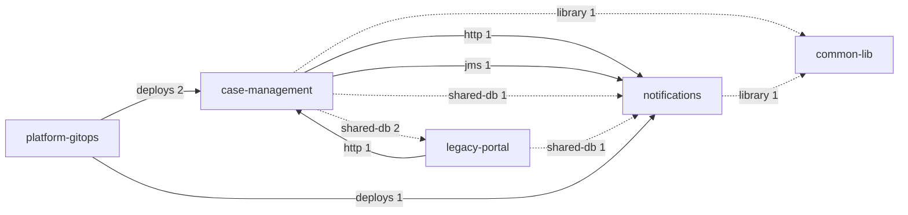

# Application portfolio — architecture and integrations

> Generated by Traverse from source code. Relationships are based on static evidence; low-confidence ones are candidates to validate.

## Executive summary

- **Scope.** 5 systems, 163 lines of code in total.
- **Integrations.** 10 inter-system relationships (0 low-confidence, to validate) and 2 shared tables.
- **Vulnerabilities.** 3 distinct across the portfolio (1 critical, 1 high).
- **Systems with the most high risks.** case-management (3), platform-gitops (3), legacy-portal (1).

## 1. System catalog

| System | Group | Languages | LOC | Runtime | Exposes | Consumes | Tables | Risks H/M/L | Document |
|---|---|---|---|---|---|---|---|---|---|
| case-management | — | Java, SQL | 87 | java 1.6 | 3 | 1 | 2 | 3/8/2 | [arc42](systems/case-management/arc42.md) |
| common-lib | — | Java | 5 | java 1.8 | 0 | 0 | 0 | 0/0/0 | [arc42](systems/common-lib/arc42.md) |
| legacy-portal | — | C#, COBOL | 16 | .NET v4.5 | 1 | 1 | 2 | 1/3/0 | [arc42](systems/legacy-portal/arc42.md) |
| notifications | — | Java | 55 | java 11 | 4 | 1 | 1 | 1/0/1 | [arc42](systems/notifications/arc42.md) |
| platform-gitops | — | — | 0 | — | 0 | 0 | 0 | 3/0/2 | [arc42](systems/platform-gitops/arc42.md) |

## 2. Integration map

## 3. Integration matrix

Rows: source (consumer); columns: target (provider).

|  | case-management | common-lib | legacy-portal | notifications | platform-gitops |
|---|---|---|---|---|---|
| **case-management** | — | library | shared-db | http, jms, shared-db | — |
| **common-lib** | — | — | — | — | — |
| **legacy-portal** | http | — | — | shared-db | — |
| **notifications** | — | library | — | — | — |
| **platform-gitops** | deploys | — | — | deploys | — |

## 4. Integration catalog between systems

| # | From | To | Kind | Mode | Keys | Evidence | Confidence |
|---|---|---|---|---|---|---|---|
| 1 | case-management | common-lib | library | build time (library) | maven:org.example:common-dto | 1 | high |
| 2 | case-management | legacy-portal | shared-db | through shared data | EXPEDIENTE; TRAMITE | 2 | medium |
| 3 | case-management | notifications | http | synchronous | POST /notifications/api/messages/send | 1 | medium |
| 4 | case-management | notifications | jms | asynchronous (messaging) | java:/jms/queue/CaseResolved | 1 | high |
| 5 | case-management | notifications | shared-db | through shared data | EXPEDIENTE | 1 | medium |
| 6 | legacy-portal | case-management | http | synchronous | GET /cases/api/expedientes/{id} | 1 | medium |
| 7 | legacy-portal | notifications | shared-db | through shared data | EXPEDIENTE | 1 | medium |
| 8 | notifications | common-lib | library | build time (library) | maven:org.example:common-dto | 1 | high |
| 9 | platform-gitops | case-management | deploys | deployment | kubernetes CronJob nightly-reconciliation ← tramitacion/case-ejb:1.4.2; kubernetes Deployment case-management ← tramitacion/case-web:1.4.2 | 2 | medium |
| 10 | platform-gitops | notifications | deploys | deployment | openshift DeploymentConfig notifications ← tramitacion/notifications:3.0.1 | 1 | medium |

> ✍️ **To complete:** owner, SLA, volume and security of each integration.

## 5. Shared data

| Table | Evidence basis | Access by system |
|---|---|---|
| EXPEDIENTE | schema | case-management:defines/read/uses/write, legacy-portal:read, notifications:read |
| TRAMITE | schema | case-management:defines/read, legacy-portal:read |

## 6. Shared libraries and versions

| Library |  | Version → systems |
|---|---|---|
| maven:org.example:common-dto | internal | 2.1.0: case-management · 2.3.0: notifications |

## 7. Dependencies outside the portfolio

| Kind | Key | Host | Systems |
|---|---|---|---|
| http | ANY /api/v1/sms | host-fc2d5daa3ef0 | notifications |

_Host names are encrypted: the report shows pseudonyms; authorised people decrypt them with `traverse reveal` and the key._

> ✍️ **To complete:** identify the external system (organisation, provider) of each dependency.

## 8. Known vulnerabilities

Source: OSV.dev (demo-vulndb) · data as of 2026-10-28T00:00:00Z

| Severity | ID | Library | Affected systems | Fixed in | Summary |
|---|---|---|---|---|---|
| Critical 9.8 | [TRAVERSEDEMO-2026-0001](https://osv.dev/vulnerability/TRAVERSEDEMO-2026-0001) TRAVERSEDEMO-CVE-0001 | maven:commons-collections:commons-collections | case-management@3.2.1 | 3.2.2 | SYNTHETIC DEMO ADVISORY - not real vulnerability data. Remote code execution through a deserialization gadget |
| High 8.1 | [TRAVERSEDEMO-2026-0002](https://osv.dev/vulnerability/TRAVERSEDEMO-2026-0002) | maven:log4j:log4j | case-management@1.2.17 | — | SYNTHETIC DEMO ADVISORY - not real vulnerability data. Unsafe network appender in an end-of-life logging library |
| Medium | [TRAVERSEDEMO-2026-0003](https://osv.dev/vulnerability/TRAVERSEDEMO-2026-0003) | nuget:log4net | legacy-portal@1.2.10.0 | 2.0.10 | SYNTHETIC DEMO ADVISORY - not real vulnerability data. XML external entity processing in configuration loader |

> ✍️ **To complete:** prioritise each library upgrade and record accepted exceptions.

