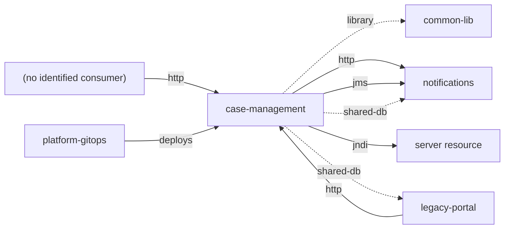
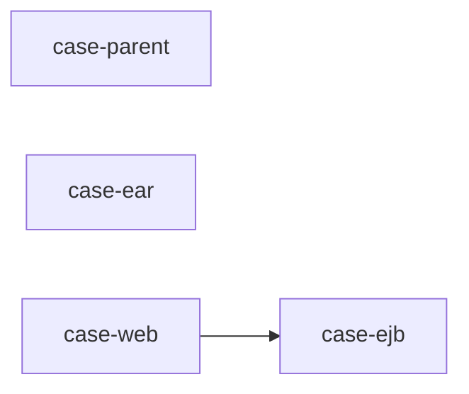
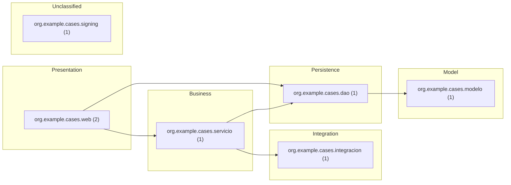

# case-management — Architecture documentation (arc42)

| Item | Value |
|---|---|
| System | case-management |
| Group | — |
| Version control | svn |
| Generated | 2025-11-05T00:00:00Z · Traverse dev · rules 2.0.0 |

> Generated from source code using the [arc42](https://arc42.org) template. Sections marked ✍️ need business knowledge or decisions that are not in the code. Everything extracted is static evidence: validate it before treating it as final.

## 1. Introduction and goals

> ✍️ **To complete:** purpose, key requirements, quality goals and stakeholders.

Size: 87 lines of code · languages: Java (83), SQL (4) · modules: 4 · components: 7.

**Analysis scope (repository structure)**

- Analyzed: `trunk` (maven:org.example.cases:case-parent 1.4.2) — main line (trunk)
- Copies of the same project left out: 2 (0 identical to the main line)
- `trunk/case-web/src/main/webapp/WEB-INF/lib`: binaries (1 files)
- `trunk/db`: SQL scripts (data model, analyzed) (1 files)

## 2. Constraints

> ✍️ **To complete:** organisational, legal and business constraints.

### 2.1 Detected technical constraints

| Kind | Constraint | Evidence |
|---|---|---|
| Runtime | java 1.6 | trunk/pom.xml |
| Platform | JBoss/WildFly | trunk/case-web/src/main/webapp/WEB-INF/web.xml |
| Database | Oracle SQL | trunk/case-ejb/src/main/java/org/example/cases/dao/ExpedienteDao.java |
| Database | Oracle Database | trunk/case-ejb/src/main/resources/META-INF/persistence.xml |
| Database | PL/SQL | trunk/db/schema.sql |

## 3. Context and scope

### 3.1 Business context

> ✍️ **To complete:** users, business areas and processes it serves.

### 3.2 Technical context

### 3.3 Integration catalog

Each row is an integration with its evidence in the code. **Direction**: inbound (others use this system), outbound (this system uses others) or shared (coupling through data). **Mode**: synchronous, asynchronous, shared data, build time or deployment.

| # | Direction | Kind | Counterpart | Key | Mode | Component | Evidence | Confidence |
|---|---|---|---|---|---|---|---|---|
| 1 | inbound | http | (no identified consumer) | ANY /cases/export/legacy | synchronous | org.example.cases.web.LegacyExportServlet | trunk/case-web/src/main/webapp/WEB-INF/web.xml:7 | high |
| 2 | inbound | http | (no identified consumer) | POST /cases/api/expedientes/{id}/resolver | synchronous | org.example.cases.web.ExpedienteResource | trunk/case-web/src/main/java/org/example/cases/web/ExpedienteResource.java:23 | high |
| 3 | inbound | http | legacy-portal | GET /cases/api/expedientes/{id} | synchronous | org.example.cases.web.ExpedienteResource | trunk/case-web/src/main/java/org/example/cases/web/ExpedienteResource.java:19 | medium |
| 4 | inbound | deploys | platform-gitops | kubernetes CronJob nightly-reconciliation ← tramitacion/case-ejb:1.4.2 | deployment | — | — | medium |
| 5 | inbound | deploys | platform-gitops | kubernetes Deployment case-management ← tramitacion/case-web:1.4.2 | deployment | — | — | medium |
| 6 | outbound | library | common-lib | maven:org.example:common-dto | build time (library) | case-parent | trunk/pom.xml:4 | high |
| 7 | outbound | http | notifications | POST /notifications/api/messages/send | synchronous | org.example.cases.integracion.NotificacionesClient | trunk/case-ejb/src/main/java/org/example/cases/integracion/NotificacionesClient.java:8 | medium |
| 8 | outbound | jms | notifications | java:/jms/queue/CaseResolved | asynchronous (messaging) | org.example.cases.servicio.GestorExpedientes | trunk/case-ejb/src/main/java/org/example/cases/servicio/GestorExpedientes.java:12 | high |
| 9 | outbound | jndi | server resource | java:comp/env/jdbc/CasesDS | synchronous | org.example.cases.dao.ExpedienteDao | trunk/case-ejb/src/main/java/org/example/cases/dao/ExpedienteDao.java:10 | medium |
| 10 | outbound | jndi | server resource | java:jboss/datasources/CasesDS | synchronous | — | trunk/case-ejb/src/main/resources/META-INF/persistence.xml:1 | high |
| 11 | outbound | jndi | server resource | jdbc/CasesDS | synchronous | — | trunk/case-web/src/main/webapp/WEB-INF/web.xml:8 | high |
| 12 | shared | shared-db | legacy-portal | EXPEDIENTE | through shared data | org.example.cases.modelo.Expediente | trunk/case-ejb/src/main/java/org/example/cases/modelo/Expediente.java:5 | medium |
| 13 | shared | shared-db | legacy-portal | TRAMITE | through shared data | — | trunk/db/schema.sql:3 | medium |
| 14 | shared | shared-db | notifications | EXPEDIENTE | through shared data | — | trunk/db/schema.sql:2 | medium |

**Summary by counterpart**

| Counterpart | Integrations |
|---|---|
| (no identified consumer) | http ×2 |
| common-lib | library ×1 |
| legacy-portal | http ×1, shared-db ×2 |
| notifications | http ×1, jms ×1, shared-db ×1 |
| platform-gitops | deploys ×2 |
| server resource | jndi ×3 |

> ✍️ **To complete:** service levels, volumes, security (authentication, encryption) and owner of each integration.

## 4. Solution strategy

> ✍️ **To complete:** fundamental decisions and their rationale.

Detected technologies:

| Area | Technologies |
|---|---|
| Authentication | AdES, Container (JAAS), Container auth (CLIENT-CERT), Timestamping, X.509 client auth |
| Business | EJB |
| Database | Oracle Database, Oracle SQL, PL/SQL |
| Delivery | Vendored libraries |
| Integration | DB network, HTTP client, HttpClient 3, JMS, JNDI |
| Logging | Log4j 1.x |
| Migration | Java EE (javax), java 1.6 |
| Persistence | Hibernate, JDBC, JPA |
| Platform | JBoss/WildFly |
| Transport Security | Custom TLS, TLS required, mTLS client |
| Web | JAX-RS, Servlet |

## 5. Building block view

### 5.1 Level 1: containers (build modules and deployment units)

| Module | Build | Packaging | Runtime | Deploys | Context root | Descriptor |
|---|---|---|---|---|---|---|
| case-parent | maven | pom | java 1.6 | — | — | trunk/pom.xml |
| case-ear | maven | ear | java 1.6 | EAR | — | trunk/case-ear/pom.xml |
| case-ejb | maven | ejb | java 1.6 | EJB | — | trunk/case-ejb/pom.xml |
| case-web | maven | war | java 1.6 | WAR | /cases | trunk/case-web/pom.xml |

### 5.2 Level 2: components by layer

| Layer | Components | Examples |
|---|---|---|
| Presentation | 2 | ExpedienteResource, LegacyExportServlet |
| Business | 1 | GestorExpedientes |
| Integration | 1 | NotificacionesClient |
| Persistence | 1 | ExpedienteDao |
| Model | 1 | Expediente |
| Unclassified | 1 | CaseResolutionSigner |

Dependency cycles: 0 · Layer violations: 1. Details in `cycles.csv` and `layer-violations.csv`.

> ✍️ **To complete:** responsibility of each block and its relevant internal interfaces.

## 6. Runtime view

Scenarios **derived statically**: from each entry point, code dependencies are followed to the reachable outbound integrations. They do not reflect actual execution order or conditions.

- **http ANY /cases/export/legacy** → LegacyExportServlet → ExpedienteDao → Expediente ⇒ db-table CASES.EXPEDIENTE (uses); db-table EXPEDIENTE (read); db-table EXPEDIENTE (write); db-table TRAMITE (read)
- **http GET /cases/api/expedientes/{id}** → ExpedienteResource → GestorExpedientes → ExpedienteDao → NotificacionesClient → Expediente ⇒ db-table CASES.EXPEDIENTE (uses); db-table EXPEDIENTE (read); db-table EXPEDIENTE (write); db-table TRAMITE (read); http ANY /notifications/api/messages/send; jms java:/jms/queue/CaseResolved
- **http POST /cases/api/expedientes/{id}/resolver** → ExpedienteResource → GestorExpedientes → ExpedienteDao → NotificacionesClient → Expediente ⇒ db-table CASES.EXPEDIENTE (uses); db-table EXPEDIENTE (read); db-table EXPEDIENTE (write); db-table TRAMITE (read); http ANY /notifications/api/messages/send; jms java:/jms/queue/CaseResolved

> ✍️ **To complete:** main business scenarios, error flows and batch processes with their schedule.

## 7. Deployment view

### 7.1 Deployment units

| Module | Kind | Context root | Source | Application paths | Includes |
|---|---|---|---|---|---|
| maven:org.example.cases:case-ear | EAR | — | — | — | web:case-web.war@/cases, ejb:case-ejb.jar |
| maven:org.example.cases:case-ejb | EJB | — | — | — | — |
| maven:org.example.cases:case-web | WAR | /cases | application.xml | /api | — |

### 7.2 Infrastructure as code

_Nothing detected._

Resources the server must provide (JNDI, modules): com.oracle.ojdbc, java:comp/env/jdbc/CasesDS, java:jboss/datasources/CasesDS, jdbc/CasesDS, org.apache.log4j

> ✍️ **To complete:** environments, physical or virtual nodes, networks, load balancers and per-environment configuration.

## 8. Cross-cutting concepts

| Concept | Detected mechanisms |
|---|---|
| Database | Oracle SQL, Oracle Database, PL/SQL |
| Logging | Log4j 1.x |
| Persistence | Hibernate, JDBC, JPA |
| Security | Secrets, Build, JBoss security domain, Servlet security |

**Inbound mTLS:** required by the application server itself (see transport mechanisms).

> ✍️ **To complete:** security model, error handling, transactions, auditing, internationalisation.

> ✍️ **To complete:** transport requirements imposed by third parties (for example, a consumer that requires mTLS) and the intermediary that enforces them (proxy, API gateway, load balancer).

## 9. Architecture decisions

> ✍️ **To complete:** relevant decisions, alternatives and consequences (ADR format recommended).

## 10. Quality requirements

> ✍️ **To complete:** quality tree and measurable scenarios.

Static indicators (indicative):

| Indicator | Value |
|---|---|
| Test code / main code | 0.00 (0 / 87 LOC) |
| Package or module cycles | 0 |
| Layer violations | 1 |
| Components without a recognisable layer | 14 % |

## 11. Risks and technical debt

| Severity | Risk | Detail | Evidence | Rule |
|---|---|---|---|---|
| High | Log4j 1.x (end of life, CVEs) | End of life since 2015 with unpatched vulnerabilities (e.g. CVE-2019-17571). | trunk/case-ejb/src/main/java/org/example/cases/servicio/GestorExpedientes.java (1) | JAVA-LOG4J1 |
| High | Outdated runtime level: java 1.6 | Java 6 or older: no supported JDK can target it; upgrade path needed. (count = modules) | trunk/pom.xml (4) | RUNTIME-LEVEL |
| High | Possible hard-coded credential in code | Value is never copied to the report. | trunk/case-ejb/src/main/java/org/example/cases/dao/ExpedienteDao.java (1) | SEC-SECRET-CODE |
| Medium | Commons HttpClient 3.x (end of life) | — | trunk/case-ejb/src/main/java/org/example/cases/integracion/NotificacionesClient.java (2) | JAVA-COMMONS-HTTPCLIENT3 |
| Medium | javax.* Java EE namespace (pre Jakarta EE 9) | Requires the javax→jakarta namespace migration for Jakarta EE 9+ runtimes. | trunk/case-ejb/src/main/java/org/example/cases/modelo/Expediente.java (1) | JAVA-JAVAX-EE |
| Medium | javax.* Java EE namespace (pre Jakarta EE 9) | Requires the javax→jakarta namespace migration for Jakarta EE 9+ runtimes. | trunk/case-ejb/src/main/java/org/example/cases/servicio/GestorExpedientes.java (2) | JAVA-JAVAX-EE |
| Medium | javax.* Java EE namespace (pre Jakarta EE 9) | Requires the javax→jakarta namespace migration for Jakarta EE 9+ runtimes. | trunk/case-web/src/main/java/org/example/cases/web/ExpedienteResource.java (2) | JAVA-JAVAX-EE |
| Medium | javax.* Java EE namespace (pre Jakarta EE 9) | Requires the javax→jakarta namespace migration for Jakarta EE 9+ runtimes. | trunk/case-web/src/main/java/org/example/cases/web/LegacyExportServlet.java (1) | JAVA-JAVAX-EE |
| Medium | JBoss / WildFly proprietary API | Couples the application to the JBoss/WildFly runtime. | trunk/case-web/src/main/webapp/WEB-INF/web.xml (1) | JAVA-JBOSS-API |
| Medium | Artifact repository over plain HTTP | Dependencies downloaded without TLS can be tampered with. | trunk/pom.xml (1) | OPS-INSECURE-REPO |
| Medium | Database-initiated network/file access | The database itself integrates with external systems. | trunk/db/schema.sql (1) | SQL-UTL-NETWORK |
| Low | Libraries committed to the repository | Dependencies without a manager: versions and CVEs are hard to track. | trunk/case-web/src/main/webapp/WEB-INF/lib/commons-collections.jar (1) | OPS-VENDORED-LIBS |
| Low | Oracle-specific SQL | Proprietary SQL hinders database portability. | trunk/case-ejb/src/main/java/org/example/cases/dao/ExpedienteDao.java (1) | SQL-ORACLE-DIALECT |

### 11.1 Known vulnerabilities

Source: OSV.dev (demo-vulndb) · data as of 2026-10-28T00:00:00Z · library versions checked: 3

| Severity | ID | Library | Fixed in | Summary | Confidence | Evidence |
|---|---|---|---|---|---|---|
| Critical 9.8 | [TRAVERSEDEMO-2026-0001](https://osv.dev/vulnerability/TRAVERSEDEMO-2026-0001) TRAVERSEDEMO-CVE-0001 | maven:commons-collections:commons-collections 3.2.1 | 3.2.2 | SYNTHETIC DEMO ADVISORY - not real vulnerability data. Remote code execution through a deserialization gadget | high | trunk/case-web/src/main/webapp/WEB-INF/lib/commons-collections.jar |
| High 8.1 | [TRAVERSEDEMO-2026-0002](https://osv.dev/vulnerability/TRAVERSEDEMO-2026-0002) | maven:log4j:log4j 1.2.17 | — | SYNTHETIC DEMO ADVISORY - not real vulnerability data. Unsafe network appender in an end-of-life logging library | high | trunk/case-ejb/pom.xml:2 |

_Offline match of declared and committed library versions against the OSV database given with --vulndb. Confidence: high = exact coordinates; medium/low = identified by JAR file name or assembly version. Transitive dependencies are evaluated only when the repository has a lockfile (no build is executed)._

> ✍️ **To complete:** business impact, likelihood and mitigation plan for each risk.

## 12. Glossary

Candidate terms (domain entities, tables, transactions):

| Term | Source | Definition |
|---|---|---|
| EXPEDIENTE | Table | ✍️ |
| Expediente | Entity (trunk/case-ejb/src/main/java/org/example/cases/modelo/Expediente.java) | ✍️ |
| TRAMITE | Table | ✍️ |

