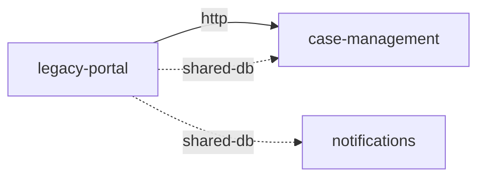
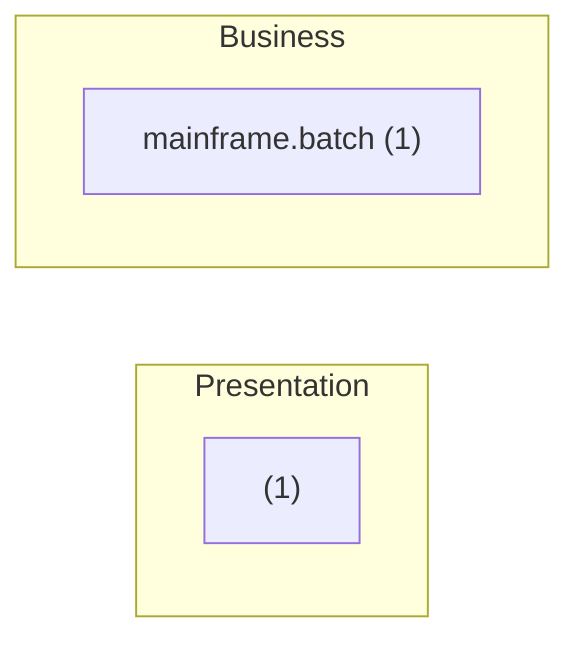

# legacy-portal — Architecture documentation (arc42)

| Item | Value |
|---|---|
| System | legacy-portal |
| Group | — |
| Version control | none |
| Generated | 2025-11-05T00:00:00Z · Traverse dev · rules 2.0.0 |

> Generated from source code using the [arc42](https://arc42.org) template. Sections marked ✍️ need business knowledge or decisions that are not in the code. Everything extracted is static evidence: validate it before treating it as final.

## 1. Introduction and goals

> ✍️ **To complete:** purpose, key requirements, quality goals and stakeholders.

Size: 16 lines of code · languages: C# (10), COBOL (6) · modules: 1 · components: 2.

**Analysis scope (repository structure)**

- Analyzed: `Portal` (msbuild:Portal)
- Analyzed: `batch`

## 2. Constraints

> ✍️ **To complete:** organisational, legal and business constraints.

### 2.1 Detected technical constraints

| Kind | Constraint | Evidence |
|---|---|---|
| Runtime | .NET v4.5 | Portal/Portal.csproj |
| Platform | .NET Framework | Portal/Portal.csproj |
| Platform | CICS | batch/NIGHTLY.cbl |
| Database | SQL Server | Portal/Default.aspx.cs |

## 3. Context and scope

### 3.1 Business context

> ✍️ **To complete:** users, business areas and processes it serves.

### 3.2 Technical context

### 3.3 Integration catalog

Each row is an integration with its evidence in the code. **Direction**: inbound (others use this system), outbound (this system uses others) or shared (coupling through data). **Mode**: synchronous, asynchronous, shared data, build time or deployment.

| # | Direction | Kind | Counterpart | Key | Mode | Component | Evidence | Confidence |
|---|---|---|---|---|---|---|---|---|
| 1 | outbound | http | case-management | GET /cases/api/expedientes/{id} | synchronous | _Default | Portal/Default.aspx.cs:7 | medium |
| 2 | shared | shared-db | case-management | EXPEDIENTE | through shared data | _Default | Portal/Default.aspx.cs:6 | medium |
| 3 | shared | shared-db | case-management | TRAMITE | through shared data | mainframe.batch.NIGHTLY | batch/NIGHTLY.cbl:5 | medium |
| 4 | shared | shared-db | notifications | EXPEDIENTE | through shared data | — | — | medium |

**Summary by counterpart**

| Counterpart | Integrations |
|---|---|
| case-management | http ×1, shared-db ×2 |
| notifications | shared-db ×1 |

> ✍️ **To complete:** service levels, volumes, security (authentication, encryption) and owner of each integration.

## 4. Solution strategy

> ✍️ **To complete:** fundamental decisions and their rationale.

Detected technologies:

| Area | Technologies |
|---|---|
| Database | SQL Server |
| Integration | IBM MQ, WCF |
| Migration | .NET v4.5 |
| Persistence | Embedded SQL |
| Platform | .NET Framework, CICS |
| Web | Web Forms |

## 5. Building block view

### 5.1 Level 1: containers (build modules and deployment units)

| Module | Build | Packaging | Runtime | Deploys | Context root | Descriptor |
|---|---|---|---|---|---|---|
| Portal.Web | msbuild | library | .NET v4.5 | — | — | Portal/Portal.csproj |

### 5.2 Level 2: components by layer

| Layer | Components | Examples |
|---|---|---|
| Presentation | 1 | _Default |
| Business | 1 | NIGHTLY |

Dependency cycles: 0 · Layer violations: 0. Details in `cycles.csv` and `layer-violations.csv`.

> ✍️ **To complete:** responsibility of each block and its relevant internal interfaces.

## 6. Runtime view

Scenarios **derived statically**: from each entry point, code dependencies are followed to the reachable outbound integrations. They do not reflect actual execution order or conditions.

_Nothing detected._

> ✍️ **To complete:** main business scenarios, error flows and batch processes with their schedule.

## 7. Deployment view

### 7.1 Deployment units

_Nothing detected._

### 7.2 Infrastructure as code

_Nothing detected._

> ✍️ **To complete:** environments, physical or virtual nodes, networks, load balancers and per-environment configuration.

## 8. Cross-cutting concepts

| Concept | Detected mechanisms |
|---|---|
| Database | SQL Server |
| Persistence | Embedded SQL |

> ✍️ **To complete:** security model, error handling, transactions, auditing, internationalisation.

> ✍️ **To complete:** transport requirements imposed by third parties (for example, a consumer that requires mTLS) and the intermediary that enforces them (proxy, API gateway, load balancer).

## 9. Architecture decisions

> ✍️ **To complete:** relevant decisions, alternatives and consequences (ADR format recommended).

## 10. Quality requirements

> ✍️ **To complete:** quality tree and measurable scenarios.

Static indicators (indicative):

| Indicator | Value |
|---|---|
| Test code / main code | 0.00 (0 / 16 LOC) |
| Package or module cycles | 0 |
| Layer violations | 0 |
| Components without a recognisable layer | 0 % |

## 11. Risks and technical debt

| Severity | Risk | Detail | Evidence | Rule |
|---|---|---|---|---|
| High | ASP.NET Web Forms | Not supported on .NET Core / .NET 5+. | Portal/Default.aspx.cs (1) | NET-WEBFORMS |
| Medium | .NET Framework (Windows only) | — | Portal/Portal.csproj (1) | NET-FRAMEWORK |
| Medium | WCF services | WCF server is not available on modern .NET (CoreWCF required). | Portal/Default.aspx.cs (1) | NET-WCF |
| Medium | Outdated runtime level: .NET v4.5 | .NET Framework is Windows-only; modern .NET requires migration. (count = modules) | Portal/Portal.csproj (1) | RUNTIME-LEVEL |

### 11.1 Known vulnerabilities

Source: OSV.dev (demo-vulndb) · data as of 2026-10-28T00:00:00Z · library versions checked: 1

| Severity | ID | Library | Fixed in | Summary | Confidence | Evidence |
|---|---|---|---|---|---|---|
| Medium | [TRAVERSEDEMO-2026-0003](https://osv.dev/vulnerability/TRAVERSEDEMO-2026-0003) | nuget:log4net 1.2.10.0 | 2.0.10 | SYNTHETIC DEMO ADVISORY - not real vulnerability data. XML external entity processing in configuration loader | low | Portal/Portal.csproj:2 |

_Offline match of declared and committed library versions against the OSV database given with --vulndb. Confidence: high = exact coordinates; medium/low = identified by JAR file name or assembly version. Transitive dependencies are evaluated only when the repository has a lockfile (no build is executed)._

> ✍️ **To complete:** business impact, likelihood and mitigation plan for each risk.

## 12. Glossary

Candidate terms (domain entities, tables, transactions):

| Term | Source | Definition |
|---|---|---|
| EXPEDIENTE | Table | ✍️ |
| TRAMITE | Table | ✍️ |

