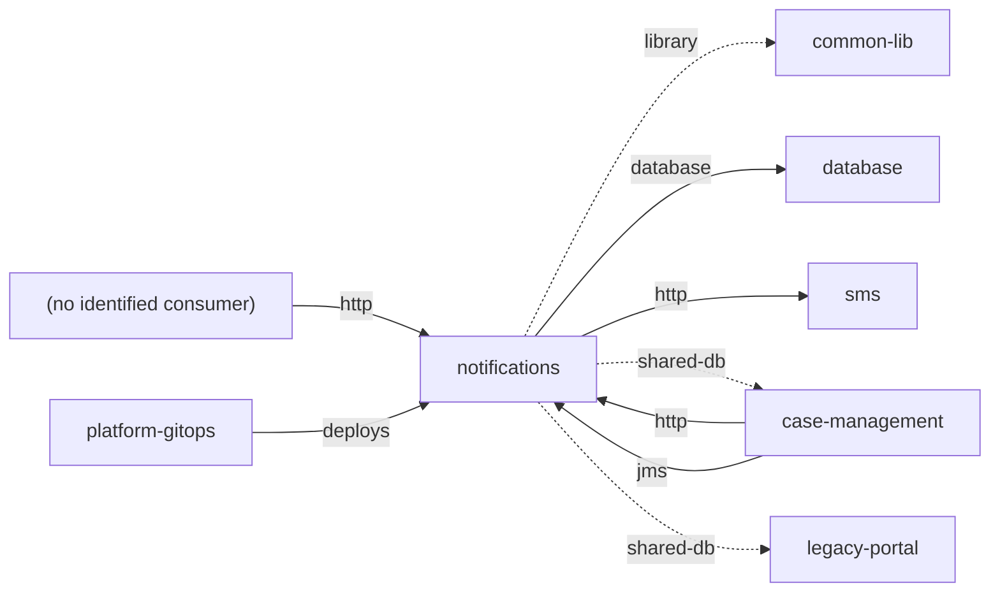
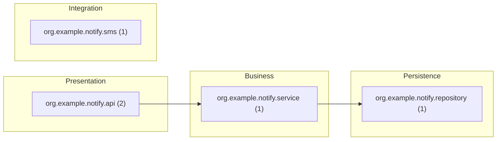
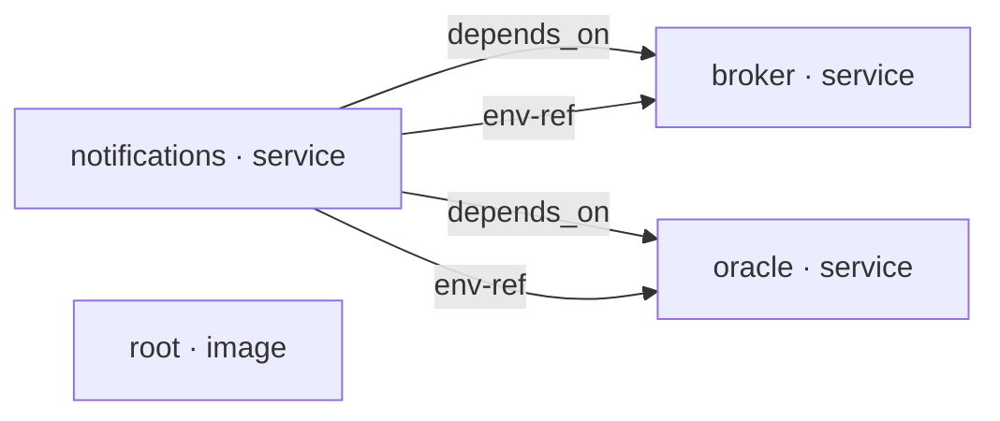

# notifications — Architecture documentation (arc42)

| Item | Value |
|---|---|
| System | notifications |
| Group | — |
| Version control | git main 4f2a9c1e7b3d |
| Generated | 2025-11-05T00:00:00Z · Traverse dev · rules 2.0.0 |

> Generated from source code using the [arc42](https://arc42.org) template. Sections marked ✍️ need business knowledge or decisions that are not in the code. Everything extracted is static evidence: validate it before treating it as final.

## 1. Introduction and goals

> ✍️ **To complete:** purpose, key requirements, quality goals and stakeholders.

Size: 55 lines of code · languages: Java (55) · modules: 1 · components: 5.

**Analysis scope (repository structure)**

- Analyzed: `.` (maven:org.example:notifications 3.0.1)

## 2. Constraints

> ✍️ **To complete:** organisational, legal and business constraints.

### 2.1 Detected technical constraints

| Kind | Constraint | Evidence |
|---|---|---|
| Runtime | java 11 | pom.xml |
| Database | Oracle SQL | src/main/java/org/example/notify/api/DeliveryReceiptController.java |
| Database | Oracle Database | docker-compose.yml |

## 3. Context and scope

### 3.1 Business context

> ✍️ **To complete:** users, business areas and processes it serves.

### 3.2 Technical context

### 3.3 Integration catalog

Each row is an integration with its evidence in the code. **Direction**: inbound (others use this system), outbound (this system uses others) or shared (coupling through data). **Mode**: synchronous, asynchronous, shared data, build time or deployment.

| # | Direction | Kind | Counterpart | Key | Mode | Component | Evidence | Confidence |
|---|---|---|---|---|---|---|---|---|
| 1 | inbound | http | (no identified consumer) | GET /notifications/api/messages/by-id/{id} | synchronous | org.example.notify.api.MessageController | src/main/java/org/example/notify/api/MessageController.java:12 | high |
| 2 | inbound | http | (no identified consumer) | GET /notifications/api/messages/{id} | synchronous | org.example.notify.api.MessageController | src/main/java/org/example/notify/api/MessageController.java:12 | high |
| 3 | inbound | http | (no identified consumer) | POST /notifications/api/receipts/delivery | synchronous | org.example.notify.api.DeliveryReceiptController | src/main/java/org/example/notify/api/DeliveryReceiptController.java:13 | high |
| 4 | inbound | http | case-management | POST /notifications/api/messages/send | synchronous | org.example.notify.api.MessageController | src/main/java/org/example/notify/api/MessageController.java:10 | medium |
| 5 | inbound | jms | case-management | java:/jms/queue/CaseResolved | asynchronous (messaging) | org.example.notify.service.MessageService | src/main/java/org/example/notify/service/MessageService.java:9 | high |
| 6 | inbound | deploys | platform-gitops | openshift DeploymentConfig notifications ← tramitacion/notifications:3.0.1 | deployment | — | — | medium |
| 7 | outbound | library | common-lib | maven:org.example:common-dto | build time (library) | notifications | pom.xml:5 | high |
| 8 | outbound | database | database · host-bb8f9d8bfaea | oracle | through shared data | — | docker-compose.yml:7 | medium |
| 9 | outbound | database | database · host-240cd640a7e5 | oracle | through shared data | — | src/main/resources/application.properties:2 | medium |
| 10 | outbound | http | sms · host-fc2d5daa3ef0 | ANY /api/v1/sms | synchronous | org.example.notify.sms.SmsGatewayClient | src/main/java/org/example/notify/sms/SmsGatewayClient.java:7 | medium |
| 11 | shared | shared-db | case-management | EXPEDIENTE | through shared data | org.example.notify.repository.CaseReadRepository | src/main/java/org/example/notify/repository/CaseReadRepository.java:7 | medium |
| 12 | shared | shared-db | legacy-portal | EXPEDIENTE | through shared data | — | — | medium |

**Summary by counterpart**

| Counterpart | Integrations |
|---|---|
| (no identified consumer) | http ×3 |
| case-management | http ×1, jms ×1, shared-db ×1 |
| common-lib | library ×1 |
| database | database ×2 |
| legacy-portal | shared-db ×1 |
| platform-gitops | deploys ×1 |
| sms | http ×1 |

> ✍️ **To complete:** service levels, volumes, security (authentication, encryption) and owner of each integration.

## 4. Solution strategy

> ✍️ **To complete:** fundamental decisions and their rationale.

Detected technologies:

| Area | Technologies |
|---|---|
| Database | Oracle Database, Oracle SQL |
| Delivery | Docker |
| Framework | Spring Boot, Spring Framework |
| Integration | HTTP client, JMS |
| Persistence | Spring JDBC |
| Transport Security | mTLS at intermediary (inferred) |
| Web | Spring MVC |

## 5. Building block view

### 5.1 Level 1: containers (build modules and deployment units)

| Module | Build | Packaging | Runtime | Deploys | Context root | Descriptor |
|---|---|---|---|---|---|---|
| notifications | maven | jar | java 11 | SERVICE | /notifications | pom.xml |

### 5.2 Level 2: components by layer

| Layer | Components | Examples |
|---|---|---|
| Presentation | 2 | DeliveryReceiptController, MessageController |
| Business | 1 | MessageService |
| Integration | 1 | SmsGatewayClient |
| Persistence | 1 | CaseReadRepository |

Dependency cycles: 0 · Layer violations: 0. Details in `cycles.csv` and `layer-violations.csv`.

> ✍️ **To complete:** responsibility of each block and its relevant internal interfaces.

## 6. Runtime view

Scenarios **derived statically**: from each entry point, code dependencies are followed to the reachable outbound integrations. They do not reflect actual execution order or conditions.

- **http GET /notifications/api/messages/by-id/{id}** → MessageController → MessageService → CaseReadRepository ⇒ db-table CASES.EXPEDIENTE (read)
- **http GET /notifications/api/messages/{id}** → MessageController → MessageService → CaseReadRepository ⇒ db-table CASES.EXPEDIENTE (read)
- **http POST /notifications/api/messages/send** → MessageController → MessageService → CaseReadRepository ⇒ db-table CASES.EXPEDIENTE (read)
- **jms jms/queue/CaseResolved** → MessageService → CaseReadRepository ⇒ db-table CASES.EXPEDIENTE (read)

> ✍️ **To complete:** main business scenarios, error flows and batch processes with their schedule.

## 7. Deployment view

### 7.1 Deployment units

| Module | Kind | Context root | Source | Application paths | Includes |
|---|---|---|---|---|---|
| maven:org.example:notifications | SERVICE | /notifications | application properties | — | — |

### 7.2 Infrastructure as code

| Platform | Kind | Name | Images | Ports | Replicas / schedule | Hosts | Module | Evidence |
|---|---|---|---|---|---|---|---|---|
| compose | service | broker | apache/activemq-artemis:latest | — | — | — | — | docker-compose.yml:13 |
| compose | service | notifications | — | 8080:8080 | — | — | maven:org.example:notifications | docker-compose.yml:3 |
| compose | service | oracle | gvenzl/oracle-xe:21-slim | — | — | — | — | docker-compose.yml:11 |
| docker | image | root | maven:3.9-eclipse-temurin-11, eclipse-temurin:11-jre | 8080 | — | — | maven:org.example:notifications | Dockerfile:1 |

> ✍️ **To complete:** environments, physical or virtual nodes, networks, load balancers and per-environment configuration.

## 8. Cross-cutting concepts

| Concept | Detected mechanisms |
|---|---|
| Database | Oracle SQL, Oracle Database |
| Persistence | Spring JDBC |
| Security | Secrets |

**Inbound mTLS:** inferred: 1 interface receives the client certificate in an HTTP header, a sign that an intermediary (proxy, API gateway, load balancer) terminates mTLS. Who requires it and which consumers use it is not in the code.

> ✍️ **To complete:** security model, error handling, transactions, auditing, internationalisation.

> ✍️ **To complete:** transport requirements imposed by third parties (for example, a consumer that requires mTLS) and the intermediary that enforces them (proxy, API gateway, load balancer).

## 9. Architecture decisions

> ✍️ **To complete:** relevant decisions, alternatives and consequences (ADR format recommended).

## 10. Quality requirements

> ✍️ **To complete:** quality tree and measurable scenarios.

Static indicators (indicative):

| Indicator | Value |
|---|---|
| Test code / main code | 0.00 (0 / 55 LOC) |
| Package or module cycles | 0 |
| Layer violations | 0 |
| Components without a recognisable layer | 0 % |

## 11. Risks and technical debt

| Severity | Risk | Detail | Evidence | Rule |
|---|---|---|---|---|
| High | Possible hard-coded credential in configuration | Value is never copied to the report; check location and rotate if real. | src/main/resources/application.properties (1) | SEC-SECRET-CONFIG |
| Low | Oracle-specific SQL | Proprietary SQL hinders database portability. | src/main/java/org/example/notify/api/DeliveryReceiptController.java (1) | SQL-ORACLE-DIALECT |

### 11.1 Known vulnerabilities

Source: OSV.dev (demo-vulndb) · data as of 2026-10-28T00:00:00Z · library versions checked: 1

No known vulnerability in the evaluated versions (this does not mean the libraries are safe: see the unevaluated list and the data date).

**Libraries whose version could not be evaluated (1)**

| Library | Declared version | Reason | File |
|---|---|---|---|
| maven:org.springframework.boot:spring-boot-starter-web | — | managed by a parent POM or BOM outside the repository | pom.xml |

_Offline match of declared and committed library versions against the OSV database given with --vulndb. Confidence: high = exact coordinates; medium/low = identified by JAR file name or assembly version. Transitive dependencies are evaluated only when the repository has a lockfile (no build is executed)._

> ✍️ **To complete:** business impact, likelihood and mitigation plan for each risk.

## 12. Glossary

Candidate terms (domain entities, tables, transactions):

| Term | Source | Definition |
|---|---|---|
| EXPEDIENTE | Table | ✍️ |

