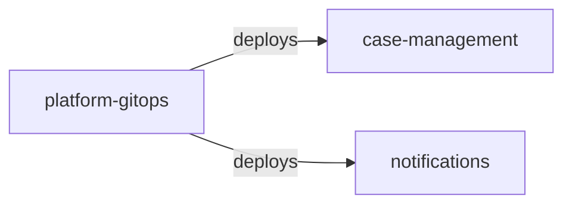
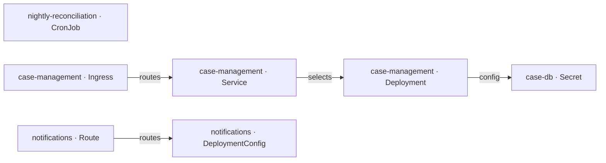

# platform-gitops — Architecture documentation (arc42)

| Item | Value |
|---|---|
| System | platform-gitops |
| Group | — |
| Version control | none |
| Generated | 2025-11-05T00:00:00Z · Traverse dev · rules 2.0.0 |

> Generated from source code using the [arc42](https://arc42.org) template. Sections marked ✍️ need business knowledge or decisions that are not in the code. Everything extracted is static evidence: validate it before treating it as final.

## 1. Introduction and goals

> ✍️ **To complete:** purpose, key requirements, quality goals and stakeholders.

Size: 0 lines of code · languages:  · modules: 0 · components: 0.

**Analysis scope (repository structure)**

- Analyzed: `apps`

## 2. Constraints

> ✍️ **To complete:** organisational, legal and business constraints.

### 2.1 Detected technical constraints

_Nothing detected._

## 3. Context and scope

### 3.1 Business context

> ✍️ **To complete:** users, business areas and processes it serves.

### 3.2 Technical context

### 3.3 Integration catalog

Each row is an integration with its evidence in the code. **Direction**: inbound (others use this system), outbound (this system uses others) or shared (coupling through data). **Mode**: synchronous, asynchronous, shared data, build time or deployment.

| # | Direction | Kind | Counterpart | Key | Mode | Component | Evidence | Confidence |
|---|---|---|---|---|---|---|---|---|
| 1 | outbound | deploys | case-management | kubernetes CronJob nightly-reconciliation ← tramitacion/case-ejb:1.4.2 | deployment | — | — | medium |
| 2 | outbound | deploys | case-management | kubernetes Deployment case-management ← tramitacion/case-web:1.4.2 | deployment | — | — | medium |
| 3 | outbound | deploys | notifications | openshift DeploymentConfig notifications ← tramitacion/notifications:3.0.1 | deployment | — | — | medium |

**Summary by counterpart**

| Counterpart | Integrations |
|---|---|
| case-management | deploys ×2 |
| notifications | deploys ×1 |

> ✍️ **To complete:** service levels, volumes, security (authentication, encryption) and owner of each integration.

## 4. Solution strategy

> ✍️ **To complete:** fundamental decisions and their rationale.

Detected technologies:

| Area | Technologies |
|---|---|
| Delivery | Kubernetes |

## 5. Building block view

### 5.1 Level 1: containers (build modules and deployment units)

_Nothing detected._

### 5.2 Level 2: components by layer

_Nothing detected._

Dependency cycles: 0 · Layer violations: 0. Details in `cycles.csv` and `layer-violations.csv`.

> ✍️ **To complete:** responsibility of each block and its relevant internal interfaces.

## 6. Runtime view

Scenarios **derived statically**: from each entry point, code dependencies are followed to the reachable outbound integrations. They do not reflect actual execution order or conditions.

_Nothing detected._

> ✍️ **To complete:** main business scenarios, error flows and batch processes with their schedule.

## 7. Deployment view

### 7.1 Deployment units

_Nothing detected._

### 7.2 Infrastructure as code

| Platform | Kind | Name | Images | Ports | Replicas / schedule | Hosts | Module | Evidence |
|---|---|---|---|---|---|---|---|---|
| kubernetes | CronJob | nightly-reconciliation | tramitacion/case-ejb:1.4.2 | — | 0 2 * * * | — | — | apps/notifications/deploy.yaml:17 |
| kubernetes | Secret | case-db | — | — | — | — | — | apps/case-management/deployment.yaml:56 |
| kubernetes | Deployment | case-management | tramitacion/case-web:1.4.2 | 8080 | 2 | host-77a3c5ab57d2 | — | apps/case-management/deployment.yaml:1 |
| kubernetes | Ingress | case-management | — | — | — | host-a42af5868ef5 | — | apps/case-management/deployment.yaml:39 |
| kubernetes | Service | case-management | — | 80→8080 | — | — | — | apps/case-management/deployment.yaml:27 |
| openshift | DeploymentConfig | notifications | tramitacion/notifications:3.0.1 | — | 1 | host-ef0ef0261b78 | — | apps/notifications/deploy.yaml:1 |
| openshift | Route | notifications | — | — | — | host-66ad369591b9 | — | apps/notifications/deploy.yaml:31 |

> ✍️ **To complete:** environments, physical or virtual nodes, networks, load balancers and per-environment configuration.

## 8. Cross-cutting concepts

| Concept | Detected mechanisms |
|---|---|
| Security | Kubernetes, Secrets |

> ✍️ **To complete:** security model, error handling, transactions, auditing, internationalisation.

> ✍️ **To complete:** transport requirements imposed by third parties (for example, a consumer that requires mTLS) and the intermediary that enforces them (proxy, API gateway, load balancer).

## 9. Architecture decisions

> ✍️ **To complete:** relevant decisions, alternatives and consequences (ADR format recommended).

## 10. Quality requirements

> ✍️ **To complete:** quality tree and measurable scenarios.

Static indicators (indicative):

| Indicator | Value |
|---|---|
| Test code / main code | 0.00 (0 / 0 LOC) |
| Package or module cycles | 0 |
| Layer violations | 0 |
| Components without a recognisable layer | 0 % |

## 11. Risks and technical debt

| Severity | Risk | Detail | Evidence | Rule |
|---|---|---|---|---|
| High | Privileged container | Privileged containers have full access to the node. | apps/case-management/deployment.yaml (1) | OPS-K8S-PRIVILEGED |
| High | Kubernetes Secret with data in the repository | Secret values are only base64-encoded; use a secret manager or sealed secrets. Values are never copied to the report. | apps/case-management/deployment.yaml (1) | OPS-K8S-SECRET-IN-REPO |
| High | Possible hard-coded credential in configuration | Value is never copied to the report; check location and rotate if real. | apps/case-management/deployment.yaml (1) | SEC-SECRET-CONFIG |
| Low | Container without resource requests/limits | Without limits a container can starve the node. | apps/case-management/deployment.yaml (1) | OPS-K8S-NO-RESOURCES |
| Low | Container without resource requests/limits | Without limits a container can starve the node. | apps/notifications/deploy.yaml (1) | OPS-K8S-NO-RESOURCES |

### 11.1 Known vulnerabilities

Source: OSV.dev (demo-vulndb) · data as of 2026-10-28T00:00:00Z · library versions checked: 0

No known vulnerability in the evaluated versions (this does not mean the libraries are safe: see the unevaluated list and the data date).

_Offline match of declared and committed library versions against the OSV database given with --vulndb. Confidence: high = exact coordinates; medium/low = identified by JAR file name or assembly version. Transitive dependencies are evaluated only when the repository has a lockfile (no build is executed)._

> ✍️ **To complete:** business impact, likelihood and mitigation plan for each risk.

## 12. Glossary

Candidate terms (domain entities, tables, transactions):

_Nothing detected._

